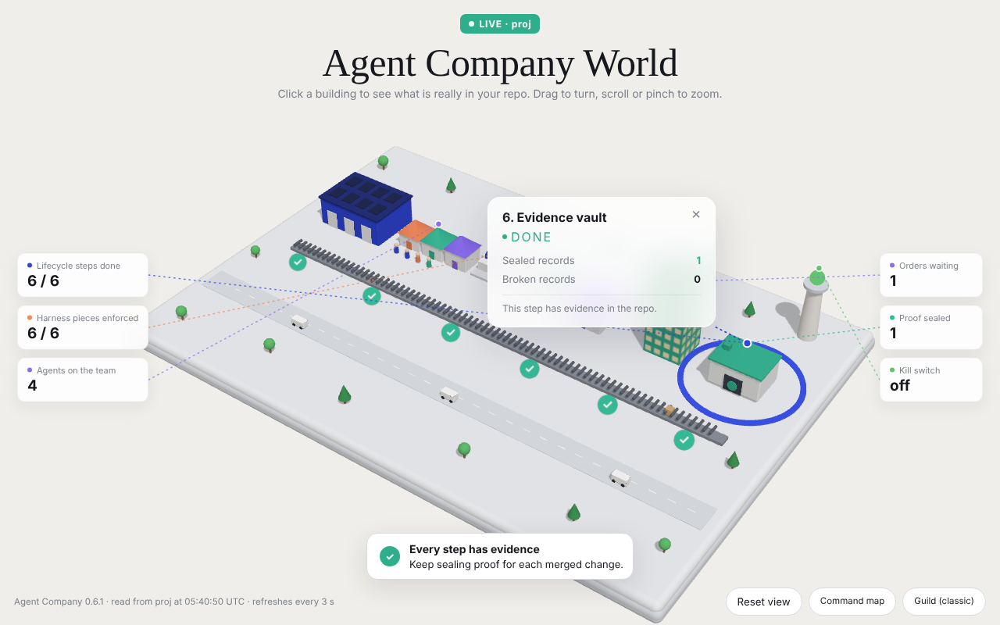
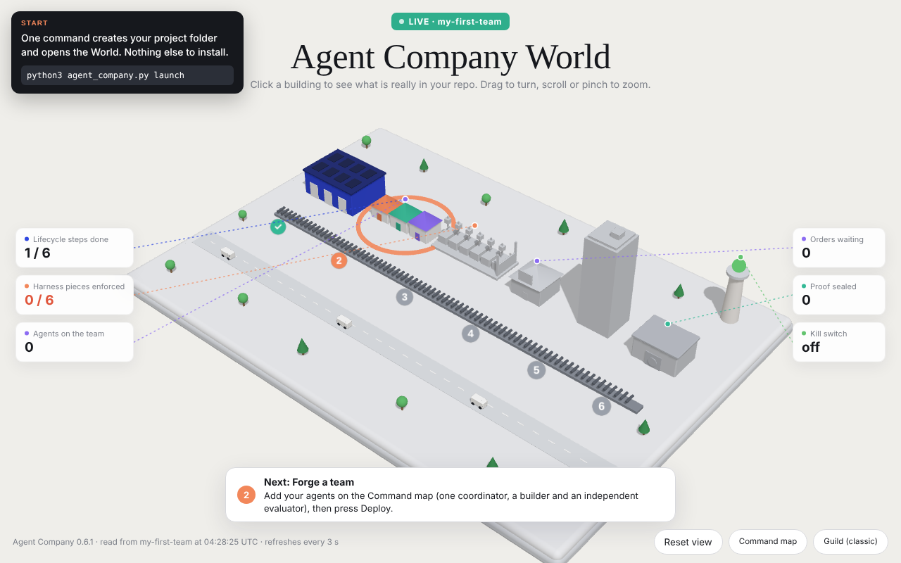
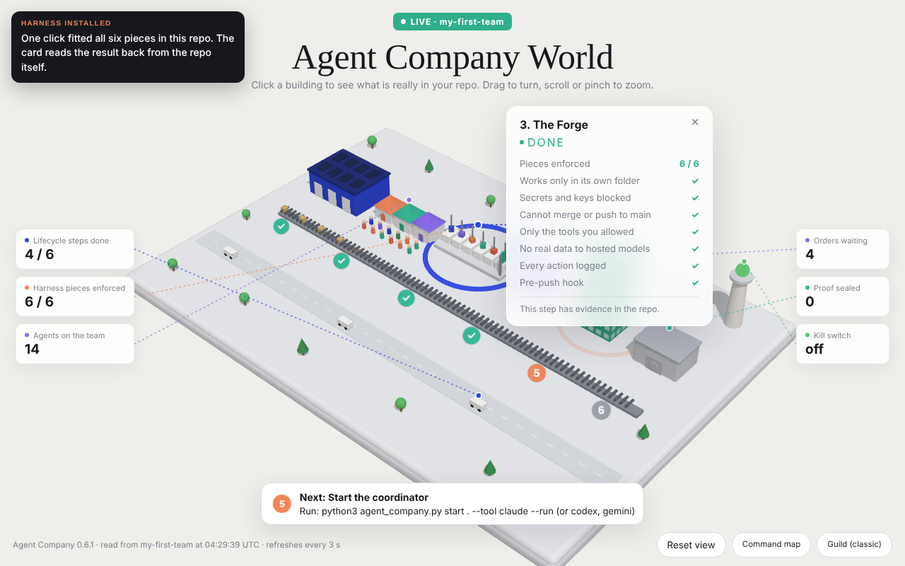
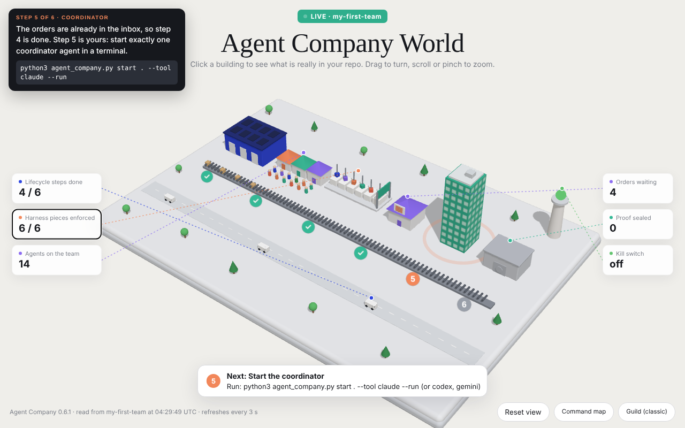
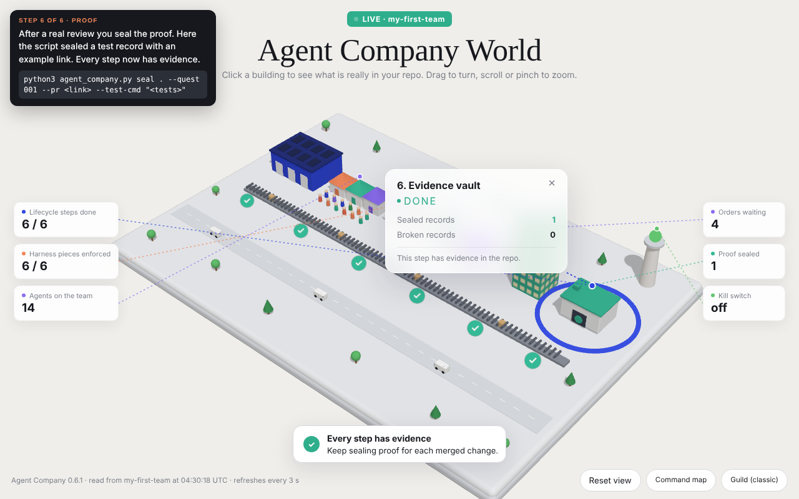
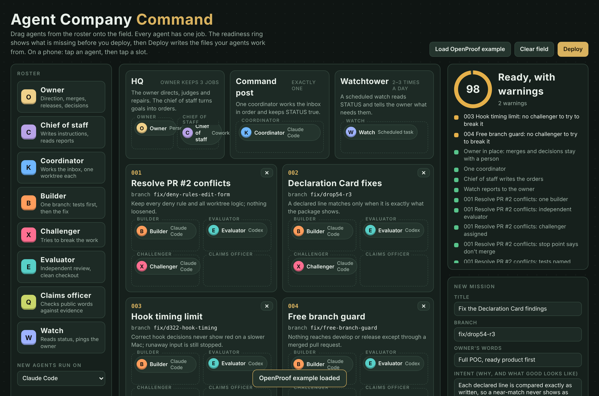

# Agent Company

**Run a team of AI agents the way you'd run a good team of people, and watch the whole deployment on one live 3D screen.**

You stay the owner: you set direction, merge and decide. Agents do the work, one job each, from written orders, with an independent reviewer and an evidence trail. Agent Company gives you two screens for that:

- **The World** (the start screen): a live 3D view of your project. Every building is one step of the deployment lifecycle and shows what is really in your repo. Steps unlock strictly in order, and the Forge's button installs the harness for real.
- **The Command map**: the planning board where you place the team and write the orders. The World links to it, and it links back.

Both write real files into your repository, and those files are what your agents work from. It works with Claude Code, Codex, Gemini CLI, Cursor and Copilot. It needs Python 3.9+ and nothing else (standard library only) and is MIT licensed.



## Demo media

| | |
|---|---|
| [**The World, start to finish**](docs/media/world-demo.mp4) (2 min 13 s) | A recorded run of the live World against a real project folder: launch, team, harness, orders, coordinator, proof. Captions say where the recording stands in for an AI agent. Guide: [docs/WORLD-GUIDE.md](docs/WORLD-GUIDE.md). |
| [**Both products in 3D**](https://claude.ai/artifact/7Tus8GCnXPjYbHNH8T17ug) | A clickable 3D showcase of Agent Company and the Harness Marketplace. Each building opens a card of figures read from the two repos' `main` branches on 20 Nov 2026. It is a snapshot and does not refresh itself. |
| [**The Line**](docs/media/the-line.mp4) (65 s) | A short narrated film, made in code, on why the World exists: loose agents and lost work, then six stations that only open in order. An illustration, not a recording of the product. Subtitles in [`.srt`](docs/media/the-line_subtitles_en.srt); source and one-command build in [`film-source/the-line/`](film-source/the-line/). |
| [**Fig 1: the Forge**](docs/media/forge-anatomy.html) | Interactive isometric figure: an agent rides past six fitting stations, each lowering one harness piece, and the deploy gate lifts only at six of six. Click to skip a piece and watch the gate refuse. |
| [**Fig 2: the dispatch line**](docs/media/agent-company-anatomy.html) | Interactive isometric figure: a mission rides one rail from the inbox through the builder's press, the challenger's probe and the evaluator's gauge to the owner's desk. Click to make the owner step away. |
| [**Fig 3: trust credits**](docs/media/trust-credits-anatomy.html) | Interactive isometric figure: the proof press and OpenProof seal, the outcome rack, the credit sight-glass, the credibility gauge and the containment cage. Click to jump to an escaped defect. |

Open the figures from a downloaded copy of the repo, since GitHub shows HTML files as source.

---

## Contents
1. [Start here](#start-here-no-setup-knowledge-needed)
2. [Start in two minutes](#start-in-two-minutes)
3. [The World](#the-world)
4. [The OpenProof harness](#the-openproof-harness)
5. [Proof: sealed evidence records](#proof-sealed-evidence-records)
6. [The Command map](#the-command-map)
7. [What gets written to your repo](#what-gets-written-to-your-repo)
8. [Command reference](#command-reference)
9. [Running the agents](#running-the-agents)
10. [Safety model](#safety-model)
11. [Review Council (self-evaluation)](#review-council-self-evaluation)
12. [Tests](#tests)
13. [Project layout](#project-layout)
14. [FAQ](#faq)
15. [Licence](#licence)

The earlier game screen, Guild mode, is documented in [docs/GUILD.md](docs/GUILD.md).

---

## Start here (no setup knowledge needed)

1. Download Agent Company (the green **Code** button → **Download ZIP**) and unzip it.
2. Double-click the start file for your computer:
   - **Mac:** **Start Agent Company.command**. The first time, macOS may ask: right-click it, choose **Open**, then **Open** again.
   - **Windows:** **Start Agent Company.bat**.
3. Your browser opens the World. The bar at the bottom shows the one next step, and the building it belongs to is ringed in orange.

It creates your first project folder at `~/agent-company-projects/my-first-team`, sets up git and Agent Company there, and opens the World. If something on your computer is missing, it says exactly what to install, in one line.

The only thing it needs is Python 3.9 or later, and git. On a Mac, git comes with `xcode-select --install`.

Prefer the terminal? `python3 agent_company.py launch [folder]` does the same thing.

**When something goes wrong:**
- `python3 agent_company.py doctor [folder]` checks your computer and the project in plain language. Each ✗ comes with the fix.
- `python3 agent_company.py smoke [folder]` is one PASS/FAIL gate before you trust a run. It writes a dated report to `docs/ops/outbox/`.

**Already have a team of Claude Code subagents?** `python3 agent_company.py import-agents <folder> --repo <project>` turns every `.claude/agents/*.md` into a team member, shown in the World's Team quarters. That works for a studio template like [Claude Code Game Studios](https://github.com/Donchitos/Claude-Code-Game-Studios), with its 49 agents. Each one gets a job from its role and the full harness. An imported agent never takes the owner's seat.

## Start in two minutes

```sh
git clone https://github.com/yencwu87-ui/agent-company.git
cd agent-company

# 1. Set up the ops folder in your project (creates docs/ops/, never overwrites)
python3 agent_company.py init ~/code/my-project

# 2. Open the World, the live 3D screen
python3 agent_company.py world ~/code/my-project
#    Your browser opens at 127.0.0.1. The bar at the bottom names the one next step.
#    Steps 2 and 4 (team and orders) are done on the Command map, which the World links to.
#    Step 3: press "Install the harness", then "Commit the harness files".

# 3. Start exactly one coordinator with your tool
python3 agent_company.py start ~/code/my-project --tool claude --run   # or codex, gemini
#    cursor and copilot print a prompt to paste into the editor's agent chat
#    with no window: python3 agent_company.py run ~/code/my-project --tool claude

# 4. Check in any time
python3 agent_company.py status ~/code/my-project
python3 agent_company.py check  ~/code/my-project
```

---

## The World

```sh
python3 agent_company.py world ~/code/my-project
```

The World is drawn from the repository every 3 seconds (`GET /api/world`), so what you see is what is there.

| Building | Shows | Done when |
|---|---|---|
| 1 Project depot | project name and version | `docs/ops/` exists |
| 2 Team quarters | one figure per agent, with role and tool | a team is saved |
| 3 The Forge | each of the six harness pieces, lit only if it is enforced, and whether the harness files are in git | 6 of 6 are enforced **and** committed; **Install the harness**, then **Commit the harness files**, do it from the screen |
| 4 Dispatch office | orders waiting and done | an instruction is in the inbox |
| 5 Coordinator tower | whether the coordinator has started, and the background runner's state | `STATUS.md` carries a real time |
| 6 Evidence vault | sealed and broken proof records | a record is sealed |
| Kill-switch tower | green when clear; red, with who and why, when `.harness/KILL` exists | n/a |

Rules the screen keeps:
- **No skipping.** A step shows as done only when every step before it is done.
- **The screen can install the harness, but it cannot approve, merge or lift the kill switch.** Those stay with a named person in the terminal, so an agent that reaches the screen cannot release itself.
- **Nothing loads from the internet.** three.js (MIT) ships in `ui/vendor/three`.

**If the repo also carries the Harness Marketplace kit** (its golden image and runtime pack, kit 1.5.0, which is on a dev branch and not released yet), the World reads two more things, and changes neither:
- **The Forge card shows the golden image:** its version and hash, and whether the repo matches it, with each drifted or missing item named. It makes the comparison the kit's own `golden check` makes, and is stricter in three ways: the kill-switch hook must be a command hook under `PreToolUse` that matches every tool, disabled hooks count as drift, and an image that lists nothing is refused. A match means the kit's standard files are in place, not that an agent behaves well.
- **The kill-switch tower shows the last recovery drill** in the kit's ledger: RECOVERED or FAILED, the seconds it took and who ran it. It is shown as written; the ledger's chain is checked by the kit's `harness.py check`, not on screen.

Neither changes which of the six steps are done. The World compares against the image file in the repo. An image that someone edits and re-hashes inside the repo is not detected, here or by the kit's own check, so compare its version and hash with the kit's release when it matters. The World reads no file through a link that leaves the repo.

### Running with no window

```sh
python3 agent_company.py harness . --commit      # once: put the harness files in git, so every worktree carries the guard
python3 agent_company.py run . --tool claude     # one coordinator, in the background, on the lowest-numbered instruction
python3 agent_company.py run . --status          # running, exited, stopped, killed or lost
python3 agent_company.py run . --stop
```

`run` refuses to start unless the harness is fitted and committed, the kill switch is off, the inbox has an instruction, and no other runner is going. It starts `claude -p`, `codex exec` or `gemini -p` with the coordinator's prompt and nothing else: it adds no flag that skips the tool's own permission checks, so a headless agent can use only the tools your project's settings allow. A supervisor watches it; `--stop`, or the kill switch file `.harness/KILL`, ends the agent's whole process group. Output goes to `docs/ops/outbox/runner.log`.

Tested with a stand-in tool only. A real `claude -p` or `codex exec` run has not been tried yet, and may need tools allowed in your settings before it can do useful work.

Teams and orders are written on the Command map; the World links to it and the Command map links back.

| | |
|---|---|
|  |  |
|  |  |

**Step-by-step guide, with a recorded run and the checks behind it:** [docs/WORLD-GUIDE.md](docs/WORLD-GUIDE.md). The earlier game screen, Guild mode, still opens with `agent_company.py guild` until the World can do everything it does; it is documented in [docs/GUILD.md](docs/GUILD.md).

---

## The OpenProof harness

The harness is what lets you send an agent out without watching every move. Each of its six pieces maps to a real limit:

| Piece | The real limit | How you enforce it |
|---|---|---|
| Worktree Helm | Works only in its own worktree, never the main folder | The coordinator's standing orders; a hook that refuses paths outside the worktree |
| Deny-rule Plate | Deny rules block secrets, keys and protected paths | Your tool's deny rules (for example `.claude/settings.json` `permissions.deny`) |
| No-merge Gauntlets | Can't merge, or push to main, develop or release | Branch rules, a pre-push hook, and the agent's own rules |
| Allowlist Belt | Only the tools and MCP servers you tick | Your tool's allowlist of tools and MCP servers |
| Constructed-data Boots | Real data never goes to a hosted model | Constructed test cases only, written into every instruction |
| Evidence Amulet | Every action leaves a record | Reports in `outbox/`, PR links, and OpenProof evidence records |

**Install it for real:** `python3 agent_company.py harness <repo>`, or the **Install the harness** button on the World's Forge. That puts enforcement into the repository:

| Piece | Enforced by |
|---|---|
| Worktree helm | `docs/ops/harness/guard.py` (a Claude Code PreToolUse hook) refuses edits and writes outside the project folder |
| Deny-rule plate | deny rules merged into `.claude/settings.json`, plus the guard, refuse reading or writing `.env`, keys, `.pem`, `id_rsa`, `.ssh` and credential files |
| No-merge gauntlets | the guard refuses `git merge`, `gh pr merge`, force and `+` pushes, `--no-verify` (in full or shortened), `--all`/`--mirror`/`--delete`, wildcard refspecs, a bare `git push`, and pushes or commits to `main`, `master`, `develop/*` and `release/*` (including `HEAD` or `@` while on them, and `heads/main` or `refs/heads/main` targets). It also refuses git aliases and unknown git subcommands, any git config except `user.name`, `user.email` and `color.ui`, changes to `.git/hooks`, `.git/config` or `core.hooksPath`, and commands hidden in `$( )`, backticks, a `( )` subshell or behind a lone `&`. A git **pre-push hook** holds every other tool (Codex, Gemini CLI, Cursor, Copilot) to the same rule |
| Allowlist belt | MCP servers and web tools are refused unless listed in `docs/ops/harness/allowlist.json` (built from the tools you tick for each agent) |
| Constructed-data boots | paths in `docs/ops/harness/real_data_paths.txt` are never read, and file uploads (`curl -F/-T`, `scp`, `rsync` to a host) are refused |
| Evidence amulet | a PostToolUse hook appends every tool call to `docs/ops/evidence/actions.jsonl` |

Your existing `.claude/settings.json` is merged rather than replaced, and the original is kept as `settings.json.before-agent-company`. An existing pre-push hook is kept, and ours is written beside it. `agent_company.py harness <repo> --check` and the Forge both show how many pieces are enforced. The owner can push past the pre-push hook on purpose with `AGENT_COMPANY_OWNER=1 git push …`; the guard refuses any agent command that sets it.

**If the guard can't read a tool call, or fails, it refuses the call** (exit 2), rather than letting it through.

**The guard is not a security boundary.** It catches mistakes and the common routes on your machine. The controls listed below under "The controls that don't depend on reading text" are what hold.

**Default deny: Bash runs only listed programs** (since 0.6.0). The guard refuses every program that isn't on its list.
- **Why:** six councils showed that a guard that blocks named tricks never catches them all. A program the guard has never heard of can carry another command past it. Wrappers such as `caffeinate`, `flock` and `strace` all did.
- **What's listed:**
  - git and gh (each with its own rules);
  - file tools: `ls`, `cat`, `grep`, `rg`, `find`, `cp`, `mv`, `rm`, `mkdir`, `diff`, `jq` and similar;
  - `agent_company.py`;
  - the test commands `python3 -m pytest`, `python3 -m unittest`, `npm test` and `node tests/…`.
- **What's never listed:** a shell. `sh`, `bash`, `zsh`, `mksh`, `busybox` and similar are refused even if you add them. Interpreters and build tools (`python3 -c`, `node -e`, `perl`, `make`) are off the list, so they're refused unless you add them.
- **Names and lookup:** programs must be run by name, not by path. Variables that change which program runs or what it loads are refused: `PATH`, `PYTHONPATH`, `NODE_OPTIONS`, `EDITOR`, `PAGER`, `LD_PRELOAD` and similar.
- **Options that start another program** are refused, abbreviations included: `tar --checkpoint-action`, `--to-command` and `-I`; `sort --compress-program`; `rg --pre`; `zip -TT`; `find -exec`.
- **Wrappers:** only the ones the guard can see through are allowed: `env` with `-i` or `-u NAME` only, `time`, `nice`, `timeout`, `nohup`, `stdbuf` and `ionice`. `sudo`, `xargs`, `exec`, `command` and `script` are refused.
- **Adding your own:** you add programs to `"programs"` and test commands to `"test_commands"` in `docs/ops/harness/allowlist.json`. Agents can't edit that file. A shell added to `"programs"` is still refused.
- **Measured:** of 42 commands a builder agent typically types, 6 are refused (14%): `npm install`, `pip install`, running a Python or Node script (2), `make` and `sed -i`. Add the ones your project needs, or let the agent use the Edit tool.

**Git is an allowlist** (since 0.5.4). Each git subcommand runs only in the forms the guard lists. Any other option is refused, including the shortened spellings git accepts, such as `--har` for `--hard`.
- **Reading:** `status`, `log`, `diff`, `show`, `blame` and similar. `--no-index`, `--output`, `--ext-diff` and `-O` are refused.
- **Working:** `add` (named files), `commit -m`, `push origin <your-branch>`, `fetch <remote>`, `checkout <local branch>` or `-b <new>`, `switch`, `restore` (named files), `reset` or `reset HEAD <file>`, `stash push, list, show, pop, apply`, `branch <new>`, `rm`, `git mv` from the inbox to `done/`, and `tag -l`.
- **Global options:** `-C` (the top folder of a worktree only), `-c` (user.name, user.email and color.ui, plain ASCII, never the owner's name) and `--no-pager` or `-P` only. `git config --edit` is refused, and so are `EDITOR`, `VISUAL`, `PAGER` and loader variables. Remote URLs, credential helpers and http headers can hold tokens, so agents can't read them: `git config --list`, `config --get remote.*.url`, `git remote -v`, `remote get-url` and `remote show` are refused. Agents list remote names with `git remote`. Agents can't change the owner's `--global` or `--system` git config.
- **Refused:** everything else, including `merge`, `pull`, `rebase`, `cherry-pick`, `revert`, `am`, `apply`, `bisect`, `clean`, `notes`, making tags, and changing remotes.

`patch`, `unzip`, `tar -x` and other archive extractors are refused, because the guard can't see the paths inside them. Use the Edit tool.

**What the guard also refuses** (added after the 8 Nov Review Council):
- **Changes to the harness itself:** writes to `docs/ops/harness/` or `.claude/settings.json`, and anything inside `.git`. Paths are resolved first, so symlinks, `.git//hooks` and `.GIT` don't get past it.
- **Changing branch and then writing, in one command:** `git checkout main && git push …`. `git -C <dir>` is checked against that folder's branch. `cherry-pick`, `reset`, `rebase`, `revert` and `am` are refused on a protected branch. So is a worktree on one.
- **Remotes:** adding or changing a git remote, or pushing to a URL.
- **gh write commands:** gh runs with your own GitHub sign-in, so only view, list, comment and opening pull requests and issues are allowed. `gh pr merge`, `gh pr review --approve`, `gh alias`, and `gh api` calls that change anything are refused.
- **Shells and hidden names:** `sh`, `bash`, `eval`, `source`, pipes into a shell, and commands named by a variable (`$G push`).
- **Data reached indirectly:**
  - Grep, Glob and LS on secrets or real-data folders;
  - shell globs that could reach them (`cat .en?`);
  - variables, brace lists and `~user`;
  - redirects (`cat<.env`);
  - relative paths, resolved from the folder the call runs in;
  - reading, moving or deleting a folder that contains real data;
  - `git add --force`;
  - git commands that print file contents, while real data is tracked.
- **Uploads** (each spelling has a test): `curl -d@`, `--data-binary @`, `--data-urlencode @`, `--json @`, `-F f=@`, `-T`, `-K`, any `@` argument, `wget --post-file` and `--body-file`, `scp`, `rsync` to a host, and `nc`, `socat`, `telnet` and `ssh`.
- **Commands that run other commands:** `git rebase -x`, `git bisect run`, `--upload-pack` and `git grep -O`, `find -exec` and `-delete`, and `awk` with `system`.
- **Anything in your name:**
  - gh posts must carry their text on the command line (`--body`), where the guard reads it; `--body-file` is refused;
  - posts, commit messages and tag messages that say approved, signed off, LGTM, ship it, go ahead, good or OK to merge, accepted, "owner's decision" or "per owner" are refused, and so is any that names the owner;
  - before checking, the guard drops invisible characters and dots, hyphens or spaces between letters, and swaps digits and look-alike letters for the letters they imitate. That catches `appr0ved`, `ap-proved` and `L.G.T.M.`. The look-alike list is fixed and covers common Cyrillic and Greek letters only;
  - **this is a word check, so it catches the common forms only.** Approval written in other words is a known limit (see below);
  - `git commit -s`, `--trailer`, `--author`, `-F` and `--amend`, and every `GIT_*` variable such as `GIT_AUTHOR_NAME`, are refused;
  - setting `user.name` or `user.email` to the owner's name, or to "owner", is refused, with spaces, hyphens and look-alike letters ignored;
  - `gh pr create --fill` is refused, because it posts commit text the guard hasn't read.
- **Places agents read but never write:** the instruction inbox, `docs/ops/evidence/` and the root `.gitignore`, in any letter case. Every command other than readers (`cat`, `grep`, `head`, `ls` and similar) is refused there. The one exception is `git mv` of a finished instruction from the inbox to `docs/ops/done/` (exact spelling). Instructions come from you, or from the chief of staff outside the agents' sessions, or from the Guild's deploy. Evidence comes from `seal`. 
- **Git commands that can remove the harness:**
  - `git clean`;
  - `git stash -u` or `--all`;
  - `git reset --hard`;
  - `git checkout` or `restore` over paths or from another commit;
  - checking out anything that isn't a local branch;
  - switching to a branch that doesn't have the harness.
- **The owner's override,** however it's quoted.
- **Real data going into git:** `git add .`, `git add -A` and adding a folder are refused while the project holds real data. The pre-push hook refuses a push whose commits touch a real-data path. `git push -o` (push options that can set auto-merge on the host) is refused.

The Read tool may read harness files, the inbox and the evidence trail. Reading doesn't change them. `council seal` checks claim words in its own folder; run `agent_company.py claims` for the whole repo.

**What the guard can't see.** It checks which program runs and with which arguments. It can't see what a listed program does once it runs: a test suite, which can run any code an agent wrote into the tests (including pytest plugins with `-p`), or any program you add to the list yourself. The approval-word check reads commit, tag and gh text, not the contents of files an agent writes. Required owner review on the Git host is what makes such a file count for nothing.

Two more known limits:
- **Approval or a decision written in free words.** The word check above catches the common forms only.
- **Secrets the agent session already holds.** Environment dumps are refused, including behind wrappers such as `command`, `time`, `nice`, `timeout` or `env -u X`: `printenv`, `env` with no command, `export -p`, `declare -p`, `/proc/*/environ`. Recursive reads and copies (`grep -r`, `cp -r`, `tar`, the Grep tool) of a folder that holds a secret-named file are refused. Agents don't read or search git's own folder (`.git/config` holds remote URLs). So are the usual credential files: `.netrc`, `.npmrc`, `.pypirc`, `.git-credentials`, `.pgpass`, `.docker`, `.kube`, `.azure`, gh's `hosts.yml`, `~/.claude/.credentials.json`. That list of file names is fixed, so it's not a general secret detector. A program that runs code can still read a key from its own environment.

**The controls that don't depend on reading text:**
- **Keep real data outside the agents' project folder.** `doctor` and `smoke` fail while it is inside, and `harness` adds real-data paths to `.gitignore`.
- **Turn on branch protection on your Git host,** so only you can merge.
- **Give agents their own Git host account, never yours.** Anything posted is then in the agent's name, not yours. Set branch protection to require your review, so free-worded "approval" from an agent counts for nothing.
- **Keep API keys out of the agents' environment,** beyond the one the agent tool needs. The guard and the pre-push hook catch the ordinary routes on your machine. The stop an agent can't switch off is **branch protection on your Git host**: only you can merge to `main`, `develop/*` and `release/*`. Turn it on before any agent gets push rights to a repo. Until then, agents work on local branches and you push.

---

## Proof: sealed evidence records

**"Done" without evidence counts as unknown.** A finished instruction needs three things on record:

- the pull request link;
- the tests that ran;
- an independent verdict.

The **OpenProof evidence record** is what makes the proof checkable. After an approving review, the evaluator (or you) runs:

```sh
python3 agent_company.py seal <repo> --quest 001 --pr <url> --verdict approve \
        --evaluator Sera --builder Brannoc --test-cmd "python3 -m pytest -q tests"
```

`seal` **re-runs the tests itself** instead of trusting a report. It writes `docs/ops/evidence/001-<hash>.json` with:
- the commit, tree, branch, pull request and verdict;
- the test command, its exit code and a hash of its output.

Each record is:
- **hashed:** SHA-256 over its canonical content;
- **chained:** linked to the previous record in `docs/ops/evidence/ledger.jsonl`;
- **signed with Ed25519** (since 0.6.1), using `ssh-keygen`, which ships with macOS, Linux and Windows 10+:
  - the private key stays on your machine (`~/.agent-company/seal_ed25519`);
  - the public key goes into `docs/ops/evidence/allowed_signers`;
  - so anyone with the repo can check a record on their own machine. Check the key's fingerprint with the owner, or pass a signers file you trust with `verify --signers <file>`;
  - agents can't read or change either key (the guard refuses `~/.agent-company` and `docs/ops/evidence/`).
- **also signed with HMAC-SHA256** (`~/.agent-company/seal.key`), as before. The HMAC signature can only be checked on the machine that made it. A record that has only HMAC shows **INTACT, SIGNATURE NOT CHECKABLE HERE** on another machine. Hash and chain are still checked there. It never shows BROKEN just because the key is missing. On the machine that sealed it, `python3 agent_company.py cosign <repo>` adds an Ed25519 signature to those records.

`python3 agent_company.py verify <repo> [id] [--rerun]` checks the record:
- the hash, the chain and the signature;
- that the commit exists;
- that the **pull request's head is the sealed commit**, now as well as at sealing time. It asks GitHub with `gh` when you're signed in, and otherwise uses `git ls-remote` on the matching remote. If the PR moved after sealing, the record stops verifying, and `seal` refuses a checkout that isn't the PR's head;
- that the tests passed and the verdict approves;
- with `--rerun`, that the tests still pass at that commit.

If you set `OPENPROOF_VERIFY_CMD` (or pass `--verifier`), that OpenProof verifier runs on the record. Its result is sealed in too, and a failing verifier means no seal.

The World's Evidence vault (step 6) counts the sealed and broken records in the repo.

**Three rules never relax:** an agent never merges, never works on a protected branch, and never sends real data to a hosted model.

---

## The Command map

The planning board, where you place the team and write the orders. Open it with `python3 agent_company.py ui <repo>`, or open `ui/command.html` directly. Drag agents onto HQ, the command post, the watchtower and mission cards. Add missions, watch the readiness ring, then press **Deploy**. The World sends you here for steps 2 and 4, and the board links back to the World.



---

## What gets written to your repo

Everything lives in `docs/ops/` of your project:

| File | What it is | Overwritten? |
|---|---|---|
| `ROLES.md` | Who does which job, and what each must never do | Yes, on each deploy |
| `inbox/README.md` | The coordinator's standing orders | Yes |
| `inbox/NNN_<slug>.md` | One instruction per piece of work: owner's words, branch, intent, team, tests first, a stop point that says "Don't merge" | **Never**: an instruction someone may be working on is kept |
| `guild/<name>.md` | Guild mode only: one sheet per agent with its job, harness, allowed tools, rules, practices, lessons and record | Yes (it's the owner's record) |
| `guild/guild.json` | Guild mode only: its saved state. The World reads the team from it when it exists | Yes |
| `plan.json` | The saved Command map layout | Yes |
| `evidence/NNN-<hash>.json`, `evidence/ledger.jsonl` | OpenProof evidence records and their chained ledger (`seal`) | Never: append only |
| `evidence/actions.jsonl` | every tool call an agent made (the evidence amulet) | Appended |
| `evidence/trust.json` | trust credits per agent (`trust`) | Yes |
| `harness/guard.py`, `allowlist.json`, `real_data_paths.txt` | the installed harness (`harness`) | guard yes; your lists never |
| `guild/cards/<name>.md` | Declaration Cards (`card`) | Yes |
| `COORDINATOR_PROMPT.txt` | The one line that starts the coordinator | Yes |
| `outbox/STATUS.md` | Written by the coordinator, checked against the remote | Created once by `init` |
| `templates/` | Instruction, status, report and Declaration Card templates | Created once by `init` |
| `done/` | Instructions whose pull request has been merged | Moved there by the coordinator |

---

## Command reference

```text
python3 agent_company.py init   [repo]                  create docs/ops (never overwrites)
python3 agent_company.py world  [repo] [--port N] [--no-browser]   the live 3D world (the start screen)
python3 agent_company.py guild  [repo] [--port N] [--no-browser]   the earlier game screen (docs/GUILD.md)
python3 agent_company.py harness [repo] [--check] [--commit]        install the harness; --commit puts its files in git
python3 agent_company.py run    [repo] [--tool T] [--status|--stop]  one coordinator in the background, one instruction
python3 agent_company.py ui     [repo] [--port N] [--no-browser]   Command map
python3 agent_company.py launch [folder]                START HERE: folder, git and setup, then the World opens
python3 agent_company.py doctor [repo]                  plain-language checks of your computer and project, each with its fix
python3 agent_company.py smoke  [repo]                  one PASS/FAIL gate (doctor, instructions, ledger, harness); dated report in outbox/
python3 agent_company.py import-agents <folder> [--repo R] [--origin TOOL]   Claude Code subagents become team members
python3 agent_company.py check  [repo]                  check every inbox instruction; exit 1 if any fails
python3 agent_company.py seal   [repo] --quest NNN --pr URL --verdict approve --test-cmd "..." [--evaluator N] [--builder N] [--verifier CMD]
                                                        re-run the tests and write a hashed, chained, signed evidence record
python3 agent_company.py verify [repo] [id] [--rerun] [--json] [--signers F]   verify one record, or the whole ledger
python3 agent_company.py cosign [repo] [id]              add an Ed25519 signature to records this machine sealed (HMAC only)
python3 agent_company.py harness [repo] [--check]       install (or check) the six-piece harness: guard hook, deny rules, pre-push hook
python3 agent_company.py card   [repo] [agent] [--seal] write Declaration Cards (docs/ops/guild/cards/); --seal records each card's hash in the ledger
python3 agent_company.py trust  [repo] [--json] [--seal] trust credits per agent → docs/ops/evidence/trust.json; --seal makes it a re-checkable record
python3 agent_company.py status [repo]                  pending, done, last status time, what needs the owner
python3 agent_company.py council seats|protocol|agents|init|score|seal [...]   the Review Council (self-evaluation board)
python3 agent_company.py claims [paths...]              check public text for claim words (warranty, certified, compliant, secure, safe, guaranteed, best); exit 1 if any   # claims-ok: the word list itself
python3 agent_company.py start  [repo] --tool claude|codex|gemini|cursor|copilot [--run]
python3 agent_company.py --version
```

`check` refuses an instruction that:
- is missing the owner's words, a branch, tests, or a "Don't merge" stop point;
- builds on `main`, `master`, `develop`, `develop/*`, `release` or `release/*`;
- isn't named `NNN_short-name.md`.

---

## Running the agents

1. Follow the World: place the team and write the orders on the Command map, press **Deploy**, then **Write to my repo**. Back on the World, install and commit the harness from the Forge.
2. Start **exactly one** coordinator: `agent_company.py start <repo> --tool claude --run`, or in the background with `agent_company.py run <repo> --tool claude`.
3. The coordinator reads `inbox/` in order. For each instruction it opens one worktree, has the builder write failing tests first, then the change, then opens a pull request and an evaluator brief, and stops. **It never merges.**
4. The evaluator (ideally from a different vendor) reviews from a clean checkout, and the challenger tries to break the work.
5. You merge. The coordinator moves the instruction to `done/` and writes a report with the evidence.
6. The evaluator (or you) runs `seal`. The World's Evidence vault then shows the sealed record.
7. A watch that you schedule with your own tool reads `outbox/STATUS.md` two or three times a day and tells you only when you're needed. Agent Company defines the role; it does not run the schedule.

---

## Safety model

**The local server**
- Listens on `127.0.0.1` only, with a random one-time token in the address. Every API call without the token is refused.
- Accepts JSON only, up to 2 MB per request and 100 kB per file.

**What it writes**
- Only the file names listed above, under `docs/ops/`. Path tricks such as `../`, absolute paths or other names are refused.
- Never overwrites an existing instruction file. Refuses an instruction that fails `check`.

**What it never does**
- Nothing in this tool merges, pushes, deletes or starts an agent on its own. `start` only prints the command, unless you add `--run`.

**The browser pages**
- Run entirely in your browser. The Command map, opened as a file, keeps its board in your browser's local storage and sends nothing anywhere.

---

## Review Council (self-evaluation)

A board of role seats that argues a decision, or a finished piece of work, before it reaches the owner. Each seat owns one question:

| Seat | Owns the question | Stands in for |
|---|---|---|
| Owner's goal | Is this what the owner asked for, in her words, and how reversible is it? | Coordinator / designer |
| Buyer | Would a second-line or internal-audit head accept this, use it and pay for it? | Market Watch / CRO drill |
| Examiner | What does it map to, and could an auditor or regulator re-check every piece of evidence? | Controls and knowledge (KU) |
| Breaker | Which input, scenario or attack makes it fail, and is that tested? | Reviewer / breaker desk |
| Operator | Can a person with no technical knowledge install, run and recover it? | Release rehearsal / deploy |
| Claims officer | Does every statement match the proof, with no claim words? | Claims officer |
| Guardian | Could it leak real data, expose a key, get past a merge rule, or record a decision in the owner's name? | Harness / owner's standing rules |
| Purse | What does it cost in tokens, money and the owner's time, and is that worth it? | Owner (cost) |

The default board is the first seven. Purse is on call, and the Guardian always sits.

**How a council runs.** The coordinator chairs it and never argues a side.
1. `agent_company.py council init "<decision>" --options "A=…,B=…,C=don't do it"` writes the brief. For finished work, use `--self-eval`: the options are A ship, B fix then ship, C send back.
2. The seats argue in three rounds (open, debate, ratify), as Claude Code sub-agents (`agent_company.py council agents` writes `.claude/agents/council-*.md`; they are read-only). Each seat returns a scored card.
3. `council score` computes the verdict: weighted option scores, bands (GO 7.5+, GO WITH CONDITIONS 6–7.4, RESHAPE 4.5–5.9, DON'T DO IT below), a ruin cap when the Guardian or any seat sees damage that can't be undone, a one-way-door cap, and a warning when round 1 agrees too fast.
4. `council seal` puts the verdict and every round file into the evidence ledger, so an edit afterwards shows in `verify`.

**Where it can sit in the team's loop** (each is a proposal the owner switches on):
- A decision council before a plan, for anything costly or hard to undo.
- A quick self-eval council after the tests pass and before the pull request goes to the owner.
- A weekly retro council on sent-back work and escaped defects.

**Cost.** A quick council is 4 seats over 1–2 rounds: 4 to 8 sub-agent calls, with round 2 only when the seats split. A full council is about 21. Purse isn't on the quick board; seat it when the work itself spends money.

**Checks on the council itself.** Each seat gets one card per round. A ruin can be cleared only in round 3. Scores must be numbers. `seal` refuses if the council's files contain claim words, or if any file (the verdict included) differs by hash from what was scored.

These three gates are proposals, not settled practice. They start **off**. You switch each one on, or back off, in the "Review Council gates" list in `docs/ops/inbox/README.md`.

The council is a self-evaluation. It never replaces the tests, `seal`, the owner's merge or the walkthrough with the customer. The steps are in `templates/council.md`.

---

## Tests

```sh
python3 -m unittest discover -s tests -v       # 144 tests (and 590 guard and rule cases): launch, doctor, smoke, import-agents, CLI, deploy rules, local server, seal/verify and tampering, pull-request match, harness install and commit, guard decisions, hostile-command guard cases, pre-push, claim words, Review Council scoring and sealing, sealed cards and trust, the World's state and limits, the kit readout (golden image, recovery drill), the background runner
                                               # 3 of the 144 (Ed25519 signing) need ssh-keygen on the PATH
npm i -D playwright && npx playwright install chromium
node tests/test_ui.mjs                         # 45 browser checks of the Command map and the earlier Guild screen, including local mode on a real repo (harness install, record verification)
```

The World's rules are covered by the unit tests (`tests/test_world.py`); it has no browser test file yet. The browser tests cover the Command map and Guild mode:
- drag and drop, and the refusals (wrong class, incomplete harness, level-1 quest limit);
- trust credits: deductions scaled by level, Watch, containment under 15 credits or on a vow breach, restore on probation, and credibility gates on levels;
- the Forge refusing a character without the full harness;
- accept being disabled without proof, and a sealed quest giving full XP;
- talent training, world renaming, and the deploy files;
- no sideways scroll on a 390-pixel phone, and the handheld controls.

---

## Project layout

```text
agent_company.py      the CLI and the local server (standard library only)
council.py            the Review Council: seats, brief, scoring, agent files
harness/              guard.py (Claude Code hook) and pre-push, installed by `harness`
ui/world.html         the World: live 3D view of the repo (three.js in ui/vendor/three)
ui/guild.html         the earlier game screen, Guild mode (docs/GUILD.md)
ui/command.html       the Command map
ui/anatomy.html       interactive figure: how work moves down the dispatch line
templates/            instruction, status, report, Declaration Card and council protocol templates
scripts/              init_company.py and check_inbox.py (kept for older set-ups)
tests/                unittest suites (CLI, proof, start, guard cases, council) and test_ui.mjs (Playwright)
docs/screens/         screenshots used in this README, the World guide and docs/GUILD.md
docs/media/           demo videos and figures
film-source/          source of the two films: the-line/ (The Line) and the earlier feature film (page driver, voice lines, mix)
SKILL.md              the Agent Skill: principles, roles, the playbook, mission discipline
install.sh            install from a release zip
```

**As an Agent Skill:** `SKILL.md` follows the open Agent Skills format, so any tool that reads skills can load it. Copy the folder into your tool's skills directory, for example `~/.claude/skills/agent-company/`.

---

## FAQ

**Does it work without the 3D screen?** Yes. Use `ui` for the Command map, or write the inbox files by hand from `templates/` and run `check`.

**Which agent tools?** Any tool that reads files and runs in a folder: Claude Code, Codex, Gemini CLI, Cursor, Copilot and others. The tool you pick for an agent is only a label, used to warn when the evaluator runs on the same tool as the builder.

**Does it work on a phone?** The World fits a 390-pixel-wide screen with no sideways scroll. It is served from your computer, so your repo stays there.

**Does the harness stop every mistake?** No tool can promise that. The harness lists the limits each agent must work within, the World keeps step 3 open until all six are enforced and committed, and `harness` enforces them on your machine with the guard and the pre-push hook. What it can't see is listed under [The OpenProof harness](#the-openproof-harness); branch protection on your Git host is the final stop.

**Where's the evidence record from?** From OpenProof, which assesses an agent's result before it goes live and records evidence anyone can re-check. Agent Company works without it; the record is what moves a piece of work from self-reported to sealed.

---

## Licence

MIT. See [LICENSE](LICENSE). By OpenProof · wuyenching087@gmail.com

## Credits

The start-here flow, the smoke gate, agent import and the Review Council borrow ideas from three MIT-licensed projects:
- [Claude Code Game Studios](https://github.com/Donchitos/Claude-Code-Game-Studios): stage detection with one next step; a smoke check as the gate before QA; "could not run" rather than a guessed report.
- [Godot MCP](https://github.com/Coding-Solo/godot-mcp): errors reported straight back so they can be fixed.
- [Roast Room](https://github.com/nateherkai/roast-room) (AI Automation Society): the council mechanism (a Chair who never argues, seats that each own one question, three rounds, weighted scores, verdict bands, the ruin and one-way-door caps). Agent Company's seats are original roles, not simulations of real people.

No code was copied from any of them.
