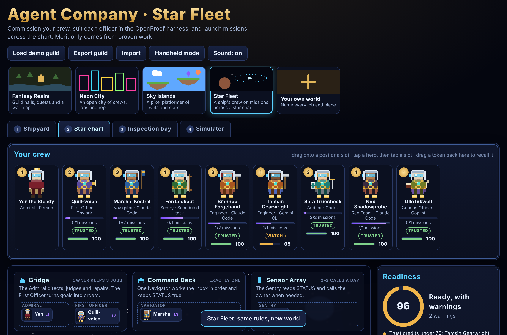
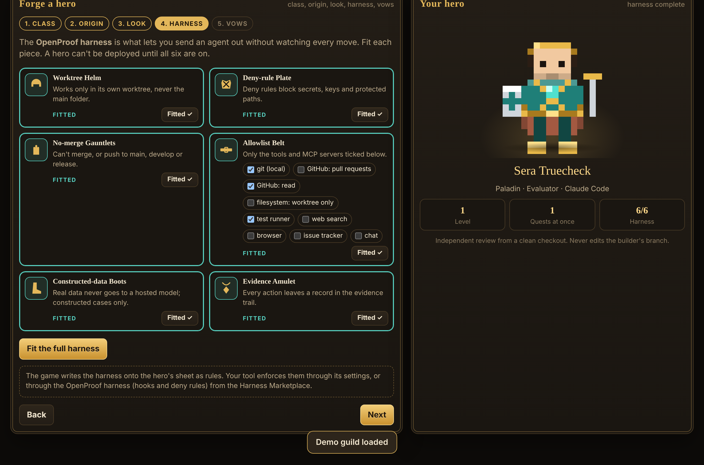
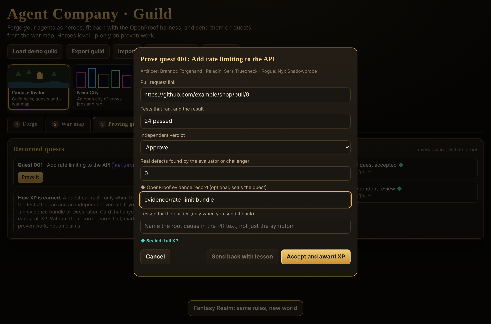
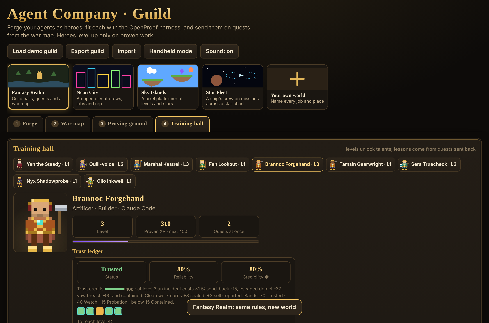
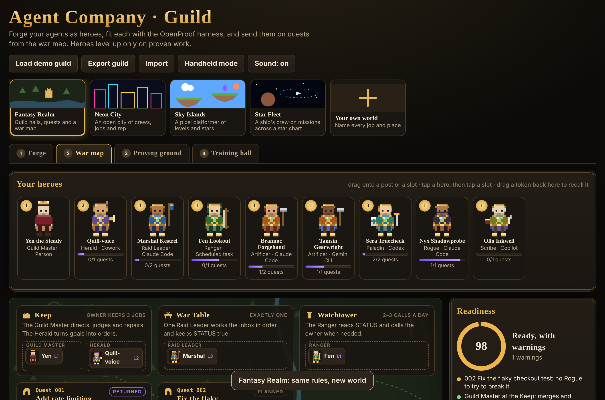
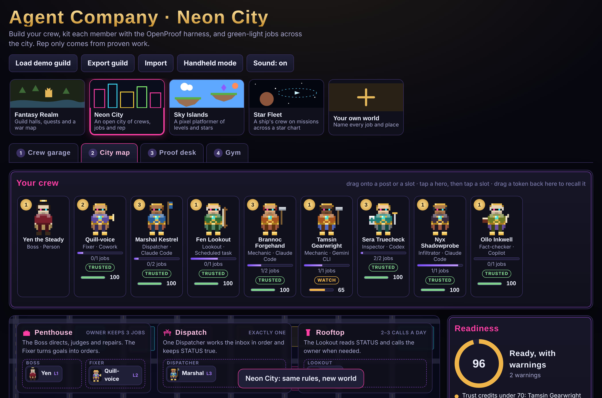
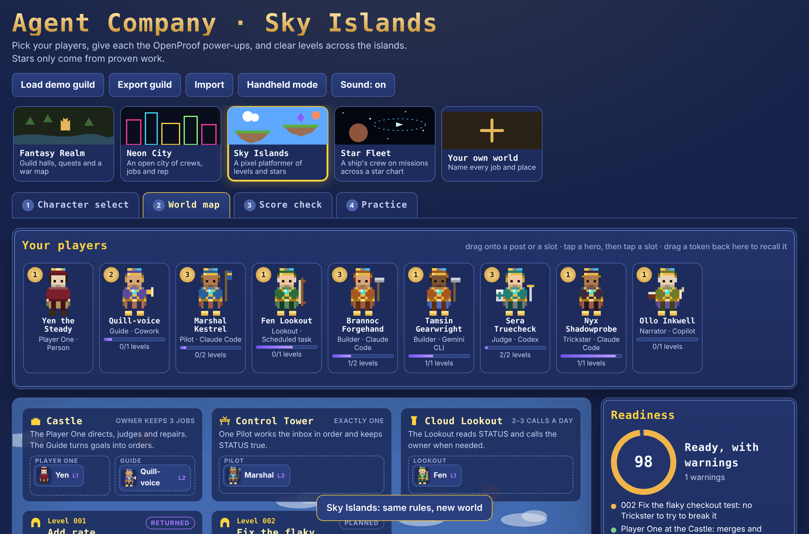
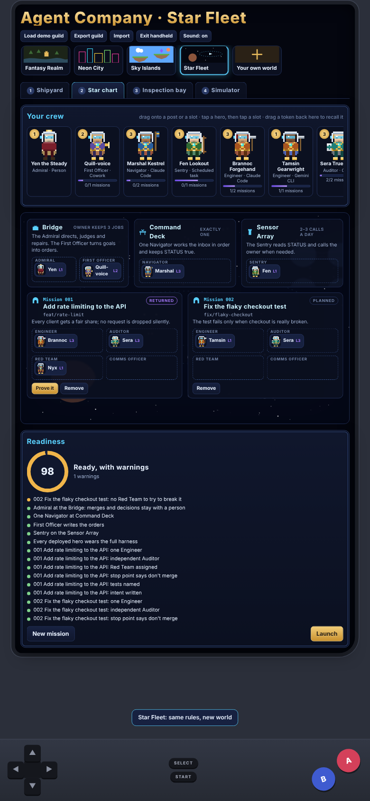
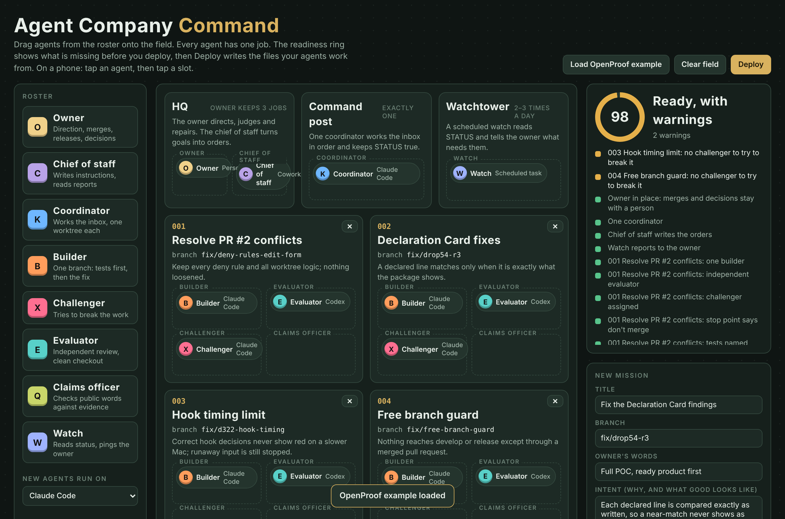

# Agent Company

**Run a team of AI agents the way you'd run a good team of people, and learn it by playing a game.**

You stay the owner: you set direction, merge and decide. Agents do the work, one job each, from written orders, with an independent reviewer and an evidence trail. Agent Company gives you two ways to set that up:

- **Command map**: a drag-and-drop planning board for people who want the plain version.
- **Guild mode**: the same rules played as a game. You forge agent characters, fit them with the OpenProof harness, deploy them on a map and level them up, but only on proven work. It plays on a laptop or a phone, including a handheld mode with a D-pad.

Both write real files into your repository, and those files are what your agents work from. It works with Claude Code, Codex, Gemini CLI, Cursor and Copilot. It needs Python 3.9+ and nothing else (standard library only) and is MIT licensed.



## Demo media

| | |
|---|---|
| [**Feature film**](docs/media/agent-company-feature-film.mp4) (77 s) | Told with three anatomy figures, plus short live demos of the real game: the Forge fitting the harness, deploying on the map (a refused drop, the green ring, the horn), the dispatch line, proving a quest and levelling up, trust credits and containment, and the worlds on a laptop and a phone. Captions in [`.srt`](docs/media/agent-company-feature-film.srt). |
| [**Fig 1: the Forge**](docs/media/forge-anatomy.html) | Interactive isometric figure: an agent rides past six fitting stations, each lowering one harness piece, and the deploy gate lifts only at six of six. Click to skip a piece and watch the gate refuse. |
| [**Fig 2: the dispatch line**](docs/media/agent-company-anatomy.html) | Interactive isometric figure: a mission rides one rail from the inbox through the builder's press, the challenger's probe and the evaluator's gauge to the owner's desk. Click to make the owner step away. |
| [**Fig 3: trust credits**](docs/media/trust-credits-anatomy.html) | Interactive isometric figure: the proof press and OpenProof seal, the outcome rack, the credit sight-glass, the credibility gauge and the containment cage. Click to jump to an escaped defect. |

Open the figures from a downloaded copy of the repo, since GitHub shows HTML files as source.

---

## Contents
1. [Start in two minutes](#start-in-two-minutes)
2. [Why a game?](#why-a-game)
3. [Guild mode, step by step](#guild-mode-step-by-step)
4. [Worlds](#worlds)
5. [Handheld mode](#handheld-mode)
6. [The OpenProof harness](#the-openproof-harness)
7. [Proof, XP and levels](#proof-xp-and-levels)
8. [Trust: credits, reliability, credibility](#trust-credits-reliability-credibility)
9. [The Command map](#the-command-map)
10. [What gets written to your repo](#what-gets-written-to-your-repo)
11. [Command reference](#command-reference)
12. [Running the agents](#running-the-agents)
13. [Safety model](#safety-model)
14. [Tests](#tests)
15. [Project layout](#project-layout)
16. [FAQ](#faq)
17. [Licence](#licence)

---

## Start in two minutes

```sh
git clone https://github.com/yencwu87-ui/agent-company.git
cd agent-company

# 1. Set up the ops folder in your project (creates docs/ops/, never overwrites)
python3 agent_company.py init ~/code/my-project

# 2. Play Guild mode (or `ui` for the plain Command map)
python3 agent_company.py guild ~/code/my-project
#    Your browser opens at 127.0.0.1. Forge heroes, fit the harness, drag them onto the map.
#    When the readiness ring is green, press the deploy button, then "Write to my repo".

# 3. Start exactly one coordinator with your tool
python3 agent_company.py start ~/code/my-project --tool claude --run   # or codex, gemini
#    cursor and copilot print a prompt to paste into the editor's agent chat

# 4. Check in any time
python3 agent_company.py status ~/code/my-project
python3 agent_company.py check  ~/code/my-project
```

You can also open `ui/guild.html` directly in a browser to try it with no install. It starts with a demo guild. In that mode, deploy shows the files for you to copy instead of writing them.

---

## Why a game?

People learn by doing and by seeing. Most guides to multi-agent work are walls of rules. In Guild mode every rule becomes something you can see happen, so you learn it by playing:

| You do this in the game | You're learning this |
|---|---|
| Pick a **class** for a character | One agent, one job. A builder never reviews its own work. |
| Pick an **origin** | Which tool the agent runs on. A reviewer from a different vendor catches more. |
| Fit six pieces of **harness** gear | The limits an agent needs before you can leave it alone. |
| Drop a character in the **wrong slot** and get refused | Team rules: one coordinator, one builder per branch, an independent evaluator. |
| Watch the **readiness ring** turn green | What "ready to deploy" means. |
| Write a **quest** | A good instruction: the owner's words, intent, branch, tests, and a stop point that says "Don't merge". |
| Earn **XP** only with proof | "Done" without evidence counts as unknown. |
| Train **talents** and keep **lessons** | Turning experience into standing practice. |
| Hold more quests as you **level up** | Trust is earned, and it's earned in steps. |
| Never break your **vows** | Some rules never relax, at any level. |

Once you've played a round, you've designed a real team, and the files are already in your repo.

---

## Guild mode, step by step

There are four rooms. Their names change with the world; the Fantasy Realm names are shown here.

### 1. Forge: build a character
- **Class** is the job. There are eight classes, each mapped to a real role:

  | Class | Role | Does | Never |
  |---|---|---|---|
  | Guild Master | Owner (a person) | Directs, judges, merges | Builds |
  | Herald | Chief of staff | Turns goals into written orders | Builds or merges |
  | Raid Leader | Coordinator | Works the inbox in order, one worktree per quest | Builds in the main folder or merges |
  | Artificer | Builder | One branch: failing tests first, then the change | Reviews own work or merges |
  | Paladin | Evaluator | Independent review from a clean checkout | Edits the builder's branch |
  | Rogue | Challenger | Tries to break the work | Fixes |
  | Scribe | Claims officer | Checks public words against evidence | Approves content |
  | Ranger | Watch | Reads status on a schedule, calls the owner | Anything else |

- **Origin** is the tool: Claude Code, Codex, Gemini CLI, Cursor, Copilot, Cowork, a scheduled task, or Person for the owner.
- **Look** is a name, skin, hair and tunic. Every character is an original pixel sprite.
- **Harness** is six pieces of gear (see [below](#the-openproof-harness)). You can't finish the character without all six.
- **Vows** are three rules that never change.



### 2. War map: deploy
Drag characters from your roster onto **posts** (Keep, War Table, Watchtower) and onto **quest** slots (Artificer, Paladin, Rogue, Scribe). On a touch screen, tap a character, then tap a slot. Drag a token back to the roster to recall it.

The game refuses a move and says why when:
- the class doesn't match the slot;
- the harness isn't complete;
- a level-1 character already holds as many quests as its level allows;
- a character already holds a post.

The **readiness ring** checks the whole team: one owner, exactly one coordinator, one builder and an independent evaluator per quest, no protected branches, no shared branches, "Don't merge" in every stop point, tests named and intent written. It also warns when the evaluator runs on the same tool as the builder.

**Sound the horn** writes the orders, and quests move from *planned* to *deployed*. If something is still blocking, the orders are shown but the quests stay planned.

### 3. Proving ground: earn XP with proof
When a quest comes back, mark it **returned** and press **Prove it**. Then record the proof:
- the pull request link;
- the tests that ran;
- the independent verdict;
- real defects found;
- optionally, an **OpenProof evidence record**.

Then you either **Accept** or **Send back with a lesson**. The [rules](#proof-xp-and-levels) decide who earns what, and the **Chronicle** keeps every award with its proof.



### 4. Training hall: level up
Each class has a talent tree with three tiers, unlocked at levels 2, 4 and 6. Each tier offers two options. A trained talent becomes a **standing practice** on the character's sheet, for example "Red first: shows the failing test before the change" or "Re-run it: re-runs the named tests instead of trusting the report". **Lessons** from quests sent back stay on the sheet too. Your agents read their sheets, so training changes how they work.



---

## Worlds

Same jobs, same rules, same files. Only the look and the words change. Pick one at the top of the page.

| World | Owner / Coordinator / Builder / Evaluator / Challenger | Places | Tasks | Points | Deploy button |
|---|---|---|---|---|---|
| **Fantasy Realm** | Guild Master / Raid Leader / Artificer / Paladin / Rogue | Keep, War Table, Watchtower | Quests | XP | Sound the horn |
| **Neon City** | Boss / Dispatcher / Mechanic / Inspector / Infiltrator | Penthouse, Dispatch, Rooftop | Jobs | Rep | Green-light the jobs |
| **Sky Islands** (pixel platformer) | Player One / Pilot / Builder / Judge / Trickster | Castle, Control Tower, Cloud Lookout | Levels | Stars | Press Start |
| **Star Fleet** | Admiral / Navigator / Engineer / Auditor / Red Team | Bridge, Command Deck, Sensor Array | Missions | Merit | Launch |
| **Your own world** | anything you name | anything you name | your word | your word | your word |

**Your own world** lets you rename all eight jobs, the three places, the task word, the points and the deploy button. You also pick a map style and an accent colour. Long-press (or right-click) its card to edit it again.

All worlds, maps and characters are original. They take inspiration from game genres, not from any particular game.

| | |
|---|---|
|  |  |
|  |  |

---

## Handheld mode

Press **Handheld mode** to play it like a pocket console. The page sits in a console shell with on-screen controls:

| Control | Does |
|---|---|
| D-pad | Moves between buttons, characters and slots |
| A | Chooses: picks up a character, drops it in a slot, presses a button |
| B | Backs out: cancels a pick, closes a dialog, goes back a Forge step |
| Start | Deploys (the horn) |
| Select | Next room |

On a keyboard, use the arrow keys, **Z** for A, **X** or **Esc** for B. Each press gives a short vibration on phones that support it.



---

## The OpenProof harness

The harness is what lets you send an agent out without watching every move. In the game each piece is drawn on the character, and each one maps to a real limit:

| Piece (Fantasy names) | The real limit | How you enforce it |
|---|---|---|
| Worktree Helm | Works only in its own worktree, never the main folder | The coordinator's standing orders; a hook that refuses paths outside the worktree |
| Deny-rule Plate | Deny rules block secrets, keys and protected paths | Your tool's deny rules (for example `.claude/settings.json` `permissions.deny`) |
| No-merge Gauntlets | Can't merge, or push to main, develop or release | Branch rules, a pre-push hook, and the agent's own rules |
| Allowlist Belt | Only the tools and MCP servers you tick | Your tool's allowlist of tools and MCP servers |
| Constructed-data Boots | Real data never goes to a hosted model | Constructed test cases only, written into every quest |
| Evidence Amulet | Every action leaves a record | Reports in `outbox/`, PR links, and OpenProof evidence records |

**Be clear about what the game does:** it writes the harness onto each character's sheet as rules. Enforcement comes from your tool's settings, or from the OpenProof harness kit (hooks and deny rules) in the [Harness Marketplace](https://github.com/yencwu87-ui/harness-marketplace). The game makes the harness visible and refuses to deploy a character without it; it doesn't install it for you.

---

## Proof, XP and levels

**No proof, no XP.** A returned quest earns nothing until you record three things:

- the pull request link;
- the tests that ran;
- an independent verdict.

The **OpenProof evidence record** is what makes the proof checkable by anyone. It can be an evidence bundle or a Declaration Card path.

| | With an OpenProof record | Without one |
|---|---|---|
| XP | Full | Half |
| Chronicle | ◆ Sealed | Self-reported |

**Awards when a quest is accepted** (full XP shown):

| Who | XP |
|---|---|
| Builder | 100 |
| Evaluator | 60 |
| Challenger | 40 |
| Claims officer | 30 |
| Coordinator | 20 |
| Each real defect found | +30 to the challenger (or the evaluator if there is no challenger) |

**Sent back with a lesson:**
- the evaluator still earns 60 for catching it;
- the builder earns 20 and keeps the lesson on its sheet;
- the quest goes back out.

**Levels:**

| Level | XP from | Holds at once | Unlocks |
|---|---|---|---|
| 1 | 0 | 1 quest | |
| 2 | 100 | 1 | talent tier 1 |
| 3 | 250 | 2 | |
| 4 | 450 | 2 | talent tier 2 |
| 5 | 700 | 3 | |
| 6 | 1000 | 3 | talent tier 3 |

**Levels need more than XP** — see the trust gates below.

**Vows never change, at any level:** never merges; never works on a protected branch; never sends real data to a hosted model. The owner doesn't level up; their job is to judge the proof.

---

## Trust: credits, reliability, credibility

Levelling up is how an agent earns trust. It works like an **error budget held as credits**: incidents spend it, proven work earns it back, and an agent that spends it all is contained.

**Every agent starts with 100 trust credits.**

| Event | Credits (levels 1–2) | Who pays |
|---|---|---|
| Accepted clean, sealed by OpenProof | +8 | each agent on the quest |
| Accepted clean, self-reported | +3 | each agent on the quest |
| Sent back in review | −10 | the builder (the evaluator caught it) |
| Escaped defect, found after acceptance | −25 | the builder |
| Missed in review (the defect escaped) | −10 | the evaluator who approved it |
| Vow breach | −60, and contained at once | the agent named |

**The stakes rise with the level.** Deductions are ×1.5 at levels 3–4 and ×2 at levels 5–6. For example, an escaped defect costs a level-5 builder 50 credits. More trust (more quests at once) means less room for failure.

| Credits | Status | What it means |
|---|---|---|
| 70–100 | **Trusted** | Normal work, can level up |
| 40–69 | **Watch** | Normal work, can level up, worth a look |
| 15–39 | **Probation** | One quest at a time, no level-ups |
| under 15 | **Contained** | Pulled off every post and quest, can't be deployed, drops a level |

**Restoring a contained agent:** the owner reviews it, refits its harness in the Forge and writes the lesson it keeps. The agent returns with **30 credits, on probation**, until it completes two sealed, clean quests and its credits recover.

**Reliability and credibility** are also shown, over the last 10 quests. Reliability is the share that came out clean. Credibility ◆ is the share sealed with an OpenProof evidence record that anyone can re-check.

**Level gates.** XP alone doesn't level an agent up. Each level also needs a track record and checkable proof:

| To reach | XP | Clean quests | Sealed by OpenProof | Trust |
|---|---|---|---|---|
| Level 2 | 100 | 1 | any | 40+ credits, not contained |
| Level 3 | 250 | 3 | 50% | 40+ credits, not contained |
| Level 4 | 450 | 5 | 60% | 40+ credits, not contained |
| Level 5 | 700 | 8 | 80% | 40+ credits, not contained |
| Level 6 | 1000 | 12 | 90% | 40+ credits, not contained |

The Training hall shows each gate with a tick, along with the credit bar and the recent outcomes. Every agent's sheet in `docs/ops/guild/` carries a Trust section, so the coordinator knows to give no work to a contained agent and one quest at a time to an agent on probation.

---

## The Command map

The plain planning board, without the game layer. Open it with `python3 agent_company.py ui <repo>`, or open `ui/command.html` directly. Drag agents onto HQ, the command post, the watchtower and mission cards. Add missions, watch the readiness ring, then press **Deploy**. It writes the same orders as Guild mode, without the character sheets.



---

## What gets written to your repo

Everything lives in `docs/ops/` of your project:

| File | What it is | Overwritten? |
|---|---|---|
| `ROLES.md` | Who does which job, and what each must never do | Yes, on each deploy |
| `inbox/README.md` | The coordinator's standing orders | Yes |
| `inbox/NNN_<slug>.md` | One instruction per quest: owner's words, branch, intent, team, tests first, a stop point that says "Don't merge" | **Never**: an instruction someone may be working on is kept |
| `guild/<name>.md` | One sheet per character: job, harness, allowed tools, vows, trained practices, lessons, record | Yes (it's the owner's record) |
| `guild/guild.json` | The saved game, so Guild mode reopens as you left it | Yes |
| `plan.json` | The saved Command map layout | Yes |
| `COORDINATOR_PROMPT.txt` | The one line that starts the coordinator | Yes |
| `outbox/STATUS.md` | Written by the coordinator, checked against the remote | Created once by `init` |
| `templates/` | Instruction, status, report and Declaration Card templates | Created once by `init` |
| `done/` | Instructions whose pull request has been merged | Moved there by the coordinator |

---

## Command reference

```text
python3 agent_company.py init   [repo]                  create docs/ops (never overwrites)
python3 agent_company.py guild  [repo] [--port N] [--no-browser]   Guild mode (the game)
python3 agent_company.py ui     [repo] [--port N] [--no-browser]   Command map
python3 agent_company.py check  [repo]                  check every inbox instruction; exit 1 if any fails
python3 agent_company.py status [repo]                  pending, done, last status time, what needs the owner
python3 agent_company.py start  [repo] --tool claude|codex|gemini|cursor|copilot [--run]
python3 agent_company.py --version
```

`check` refuses an instruction that:
- is missing the owner's words, a branch, tests, or a "Don't merge" stop point;
- builds on `main`, `master`, `develop/*` or `release/*`;
- isn't named `NNN_short-name.md`.

---

## Running the agents

1. Deploy from Guild mode or the Command map, then **Write to my repo**.
2. Start **exactly one** coordinator: `agent_company.py start <repo> --tool claude --run`.
3. The coordinator reads `inbox/` in order. For each instruction it opens one worktree, has the builder write failing tests first, then the change, then opens a pull request and an evaluator brief, and stops. **It never merges.**
4. The evaluator (ideally from a different vendor) reviews from a clean checkout, and the challenger tries to break the work.
5. You merge. The coordinator moves the instruction to `done/` and writes a report with the evidence.
6. In Guild mode, mark the quest returned, record the proof, and award XP.
7. A scheduled watch (the Ranger) reads `outbox/STATUS.md` two or three times a day and tells you only when you're needed.

---

## Safety model

**The local server**
- Listens on `127.0.0.1` only, with a random one-time token in the address. Every API call without the token is refused.
- Accepts JSON only, up to 2 MB per request and 100 kB per file.

**What it writes**
- Only the file names listed above, under `docs/ops/`. Path tricks such as `../`, absolute paths or other names are refused.
- Never overwrites an existing instruction file. Refuses an instruction that fails `check`.

**What it never does**
- Nothing in this tool merges, pushes, deletes or starts an agent on its own. `start` only prints the command, unless you add `--run`.

**The browser pages**
- Run entirely in your browser. When opened as a file, they keep the game in your browser's local storage and send nothing anywhere.

---

## Tests

```sh
python3 -m unittest discover -s tests -v       # 15 tests: CLI, refusals, deploy rules, local server and token
npm i -D playwright && npx playwright install chromium
node tests/test_ui.mjs                         # 37 browser checks: Command map, Guild, trust credits, worlds, proof/XP, handheld on a phone
```

The browser tests cover:
- drag and drop, and the refusals (wrong class, incomplete harness, level-1 quest limit);
- trust credits: deductions scaled by level, Watch, containment under 15 credits or on a vow breach, restore on probation, and credibility gates on levels;
- the Forge refusing a character without the full harness;
- accept being disabled without proof, and a sealed quest giving full XP;
- talent training, world renaming, and the deploy files;
- no sideways scroll on a 390-pixel phone, and the handheld controls.

---

## Project layout

```text
agent_company.py      the CLI and the local server (standard library only)
ui/guild.html         Guild mode: one self-contained page
ui/command.html       the Command map
ui/anatomy.html       interactive figure: how work moves down the dispatch line
templates/            instruction, status, report and Declaration Card templates
scripts/              init_company.py and check_inbox.py (kept for older set-ups)
tests/                test_cli.py (unittest) and test_ui.mjs (Playwright)
docs/screens/         screenshots used in this README
docs/media/           demo videos and figures
film-source/          the feature film's source (Lemo-Opuscar Living Screencast: page driver, voice lines, mix)
SKILL.md              the Agent Skill: principles, roles, the playbook, mission discipline
install.sh            install from a release zip
```

**As an Agent Skill:** `SKILL.md` follows the open Agent Skills format, so any tool that reads skills can load it. Copy the folder into your tool's skills directory, for example `~/.claude/skills/agent-company/`.

---

## FAQ

**Does it work without the game?** Yes. Use `ui` for the Command map, or write the inbox files by hand from `templates/` and run `check`.

**Which agent tools?** Any tool that reads files and runs in a folder: Claude Code, Codex, Gemini CLI, Cursor, Copilot and others. The origin you pick for a character is only a label, used to warn when the evaluator runs on the same tool as the builder.

**Can I play it on my phone?** Open the published page or `ui/guild.html` on your phone and turn on Handheld mode. To write into a repo, run `guild` on your computer.

**Is the XP real?** It's the owner's record of proven work, kept in `guild/` next to the code. It doesn't grade the agent by itself; you do, with the proof in front of you.

**Why trust credits?** Trust should rise with a record and fall with incidents, in the open, against the agent that caused them. Credits make the trade explicit: higher levels hold more work and pay more per incident, and no level comes without checkable proof.

**Does the harness make an agent safe?** No tool can promise that. The harness lists the limits each agent must work within, and the game won't deploy a character without them. Enforcing them is your tool's settings' job, or the OpenProof harness kit's.

**Where's the evidence record from?** From OpenProof, which assesses an agent's result before it goes live and records evidence anyone can re-check. Agent Company works without it; the record is what moves a quest from self-reported to sealed.

---

## Licence

MIT. See [LICENSE](LICENSE). By OpenProof · wuyenching087@gmail.com
