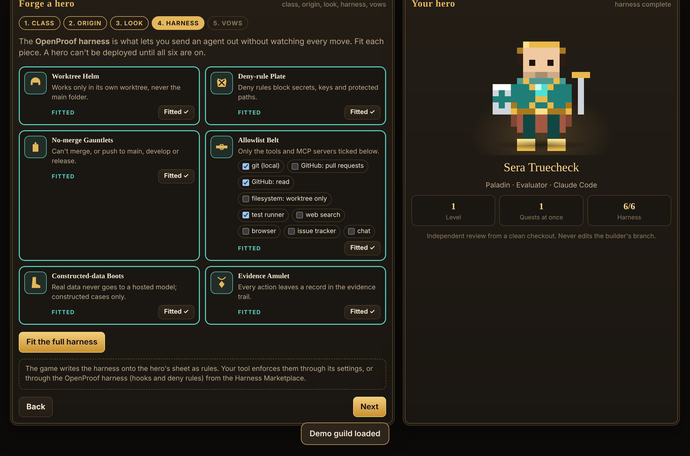
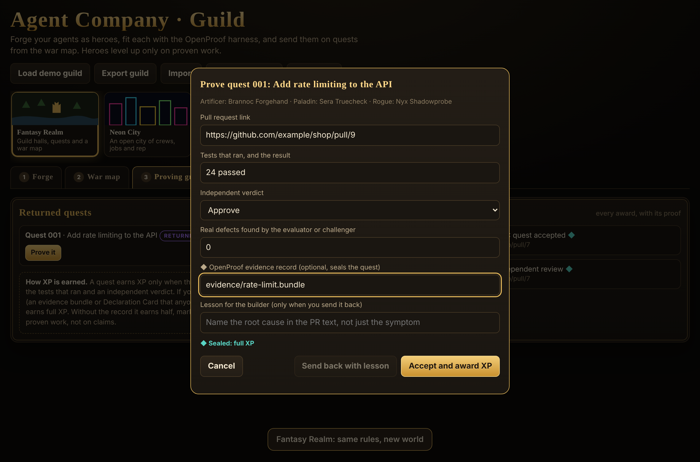
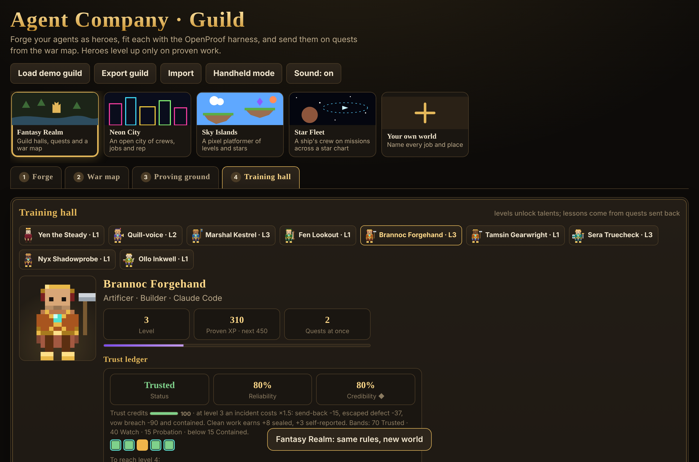
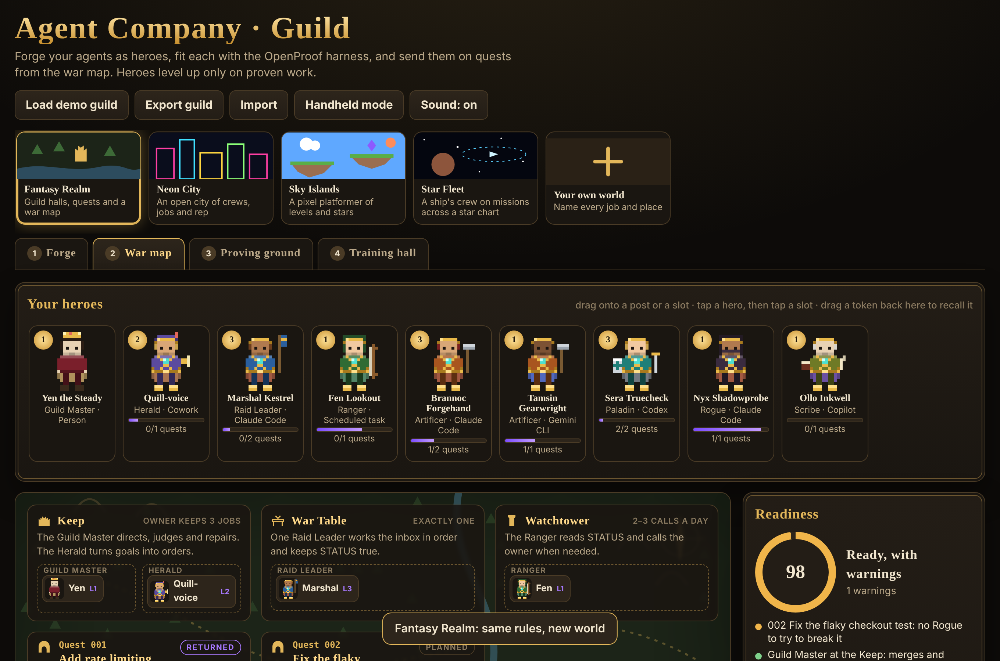
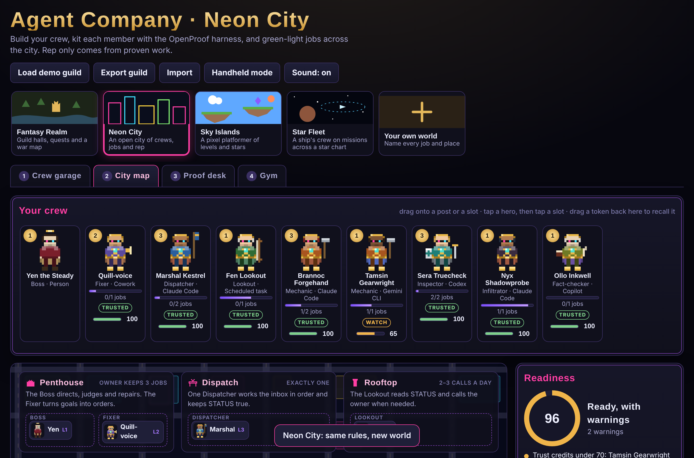
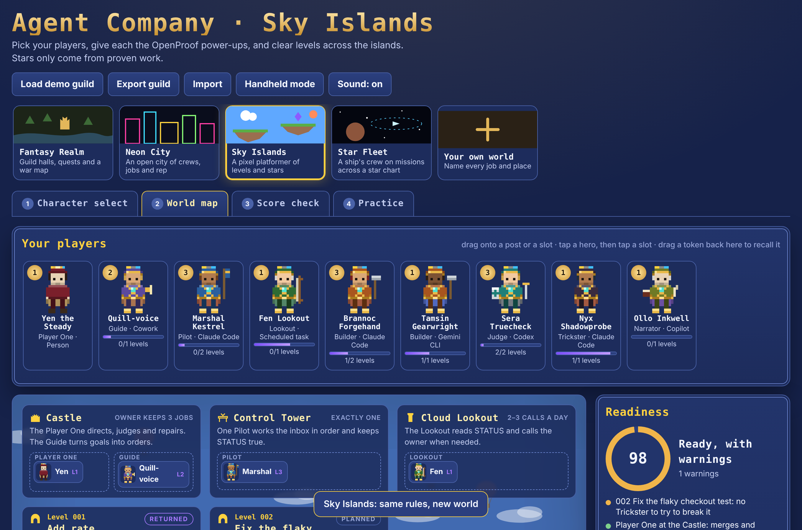
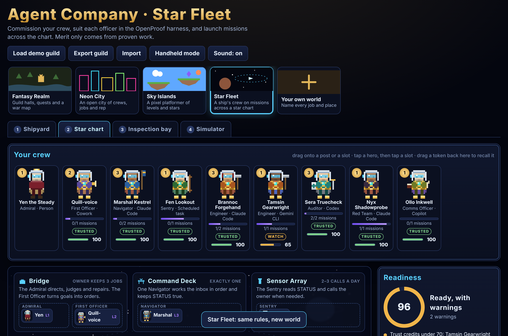
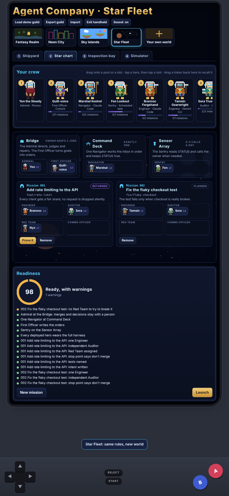

# Guild mode (the earlier game screen)

The World replaced Guild mode as the start screen on 20 Nov 2026. Guild mode still ships and opens with `python3 agent_company.py guild <repo>`, because forging characters, proving and training are not in the World yet. Everything on this page describes Guild mode only. The main guide is the [README](../README.md).

You can also open `ui/guild.html` directly in a browser to try it with no install. It starts with a demo guild. In that mode, deploy shows the files for you to copy instead of writing them.

**Film of Guild mode**

| | |
|---|---|
| [**Feature film**](media/agent-company-feature-film.mp4) (77 s) | Told with three anatomy figures, plus short live demos of the real game: the Forge fitting the harness, deploying on the map (a refused drop, the green ring, the horn), the dispatch line, proving a quest and levelling up, trust credits and containment, and the worlds on a laptop and a phone. Captions in [`.srt`](media/agent-company-feature-film.srt). |

---

## Why a game?

People learn by doing and by seeing. Most guides to multi-agent work are walls of rules. In Guild mode every rule becomes something you can see happen, so you learn it by playing:

| You do this in the game | You're learning this |
|---|---|
| Pick a **class** for a character | One agent, one job. A builder never reviews its own work. |
| Pick an **origin** | Which tool the agent runs on. A reviewer from a different vendor catches more. |
| Fit six pieces of **harness** gear | The limits an agent needs before you can leave it alone. |
| Drop a character in the **wrong slot** and get refused | Team rules: one coordinator, one builder per branch, an independent evaluator. |
| Watch the **readiness ring** turn green | What "ready to deploy" means. |
| Write a **quest** | A good instruction: the owner's words, intent, branch, tests, and a stop point that says "Don't merge". |
| Earn **XP** only with proof | "Done" without evidence counts as unknown. |
| Train **talents** and keep **lessons** | Turning experience into standing practice. |
| Hold more quests as you **level up** | Trust is earned, and it's earned in steps. |
| Never break your **vows** | Some rules never relax, at any level. |

Once you've played a round, you've designed a real team, and the files are already in your repo.

---

## Guild mode, step by step

There are four rooms. Their names change with the world; the Fantasy Realm names are shown here.

### 1. Forge: build a character
- **Class** is the job. There are eight classes, each mapped to a real role:

  | Class | Role | Does | Never |
  |---|---|---|---|
  | Guild Master | Owner (a person) | Directs, judges, merges | Builds |
  | Herald | Chief of staff | Turns goals into written orders | Builds or merges |
  | Raid Leader | Coordinator | Works the inbox in order, one worktree per quest | Builds in the main folder or merges |
  | Artificer | Builder | One branch: failing tests first, then the change | Reviews own work or merges |
  | Paladin | Evaluator | Independent review from a clean checkout | Edits the builder's branch |
  | Rogue | Challenger | Tries to break the work | Fixes |
  | Scribe | Claims officer | Checks public words against evidence | Approves content |
  | Ranger | Watch | Reads status on a schedule, calls the owner | Anything else |

- **Origin** is the tool: Claude Code, Codex, Gemini CLI, Cursor, Copilot, Cowork, a scheduled task, or Person for the owner.
- **Look** is a name, skin, hair and tunic. Every character is an original pixel sprite.
- **Harness** is six pieces of gear (see [the README](../README.md#the-openproof-harness)). You can't finish the character without all six.
- **Vows** are three rules that never change.

### 2. War map: deploy
Drag characters from your roster onto **posts** (Keep, War Table, Watchtower) and onto **quest** slots (Artificer, Paladin, Rogue, Scribe). On a touch screen, tap a character, then tap a slot. Drag a token back to the roster to recall it.

The game refuses a move and says why when:
- the class doesn't match the slot;
- the harness isn't complete;
- a level-1 character already holds as many quests as its level allows;
- a character already holds a post.

The **readiness ring** checks the whole team: one owner, exactly one coordinator, one builder and an independent evaluator per quest, no protected branches, no shared branches, "Don't merge" in every stop point, tests named and intent written. It also warns when the evaluator runs on the same tool as the builder.

**Sound the horn** writes the orders, and quests move from *planned* to *deployed*. If something is still blocking, the orders are shown but the quests stay planned.

### 3. Proving ground: earn XP with proof
When a quest comes back, mark it **returned** and press **Prove it**. Then record the proof:
- the pull request link;
- the tests that ran;
- the independent verdict;
- real defects found;
- optionally, an **OpenProof evidence record**.

Then you either **Accept** or **Send back with a lesson**. The [rules](#proof-xp-and-levels) decide who earns what, and the **Chronicle** keeps every award with its proof.

### 4. Training hall: level up
Each class has a talent tree with three tiers, unlocked at levels 2, 4 and 6. Each tier offers two options. A trained talent becomes a **standing practice** on the character's sheet, for example "Red first: shows the failing test before the change" or "Re-run it: re-runs the named tests instead of trusting the report". **Lessons** from quests sent back stay on the sheet too. Your agents read their sheets, so training changes how they work.

---

## Worlds

Same jobs, same rules, same files. Only the look and the words change. Pick one at the top of the page.

| World | Owner / Coordinator / Builder / Evaluator / Challenger | Places | Tasks | Points | Deploy button |
|---|---|---|---|---|---|
| **Fantasy Realm** | Guild Master / Raid Leader / Artificer / Paladin / Rogue | Keep, War Table, Watchtower | Quests | XP | Sound the horn |
| **Neon City** | Boss / Dispatcher / Mechanic / Inspector / Infiltrator | Penthouse, Dispatch, Rooftop | Jobs | Rep | Green-light the jobs |
| **Sky Islands** (pixel platformer) | Player One / Pilot / Builder / Judge / Trickster | Castle, Control Tower, Cloud Lookout | Levels | Stars | Press Start |
| **Star Fleet** | Admiral / Navigator / Engineer / Auditor / Red Team | Bridge, Command Deck, Sensor Array | Missions | Merit | Launch |
| **Your own world** | anything you name | anything you name | your word | your word | your word |

**Your own world** lets you rename all eight jobs, the three places, the task word, the points and the deploy button. You also pick a map style and an accent colour. Long-press (or right-click) its card to edit it again.

All worlds, maps and characters are original. They take inspiration from game genres, not from any particular game.

| | |
|---|---|
|  |  |
|  |  |

---

## Handheld mode

Press **Handheld mode** to play it like a pocket console. The page sits in a console shell with on-screen controls:

| Control | Does |
|---|---|
| D-pad | Moves between buttons, characters and slots |
| A | Chooses: picks up a character, drops it in a slot, presses a button |
| B | Backs out: cancels a pick, closes a dialog, goes back a Forge step |
| Start | Deploys (the horn) |
| Select | Next room |

On a keyboard, use the arrow keys, **Z** for A, **X** or **Esc** for B. Each press gives a short vibration on phones that support it.

---

## Proof, XP and levels

**No proof, no XP.** A returned quest earns nothing until the pull request link, the tests that ran and an independent verdict are recorded. How `seal` and `verify` work is in the [README](../README.md#proof-sealed-evidence-records).

**In Guild mode:**
- **Run locally** (`agent_company.py guild`): the Proving ground lists the quest's records, verifies the one you pick, and shows each check. Only a record that verifies earns full XP and counts as sealed for credibility. Edit a record afterwards and it stops verifying.
- **Opened in a browser alone:** a record id can't be checked, so the quest counts as self-reported, at half XP.

| | With an OpenProof record | Without one |
|---|---|---|
| XP | Full | Half |
| Chronicle | ◆ Sealed | Self-reported |

**Awards when a quest is accepted** (full XP shown):

| Who | XP |
|---|---|
| Builder | 100 |
| Evaluator | 60 |
| Challenger | 40 |
| Claims officer | 30 |
| Coordinator | 20 |
| Each real defect found | +30 to the challenger (or the evaluator if there is no challenger) |

**Sent back with a lesson:**
- the evaluator still earns 60 for catching it;
- the builder earns 20 and keeps the lesson on its sheet;
- the quest goes back out.

**Levels:**

| Level | XP from | Holds at once | Unlocks |
|---|---|---|---|
| 1 | 0 | 1 quest | |
| 2 | 100 | 1 | talent tier 1 |
| 3 | 250 | 2 | |
| 4 | 450 | 2 | talent tier 2 |
| 5 | 700 | 3 | |
| 6 | 1000 | 3 | talent tier 3 |

**Levels need more than XP** — see the trust gates below.

**Vows never change, at any level:** never merges; never works on a protected branch; never sends real data to a hosted model. The owner doesn't level up; their job is to judge the proof.

---

## Trust: credits, reliability, credibility

Levelling up is how an agent earns trust. It works like an **error budget held as credits**: incidents spend it, proven work earns it back, and an agent that spends it all is contained.

**Every agent starts with 100 trust credits.**

| Event | Credits (levels 1–2) | Who pays |
|---|---|---|
| Accepted clean, sealed by OpenProof | +8 | each agent on the quest |
| Accepted clean, self-reported | +3 | each agent on the quest |
| Sent back in review | −10 | the builder (the evaluator caught it) |
| Escaped defect, found after acceptance | −25 | the builder |
| Missed in review (the defect escaped) | −10 | the evaluator who approved it |
| Vow breach | −60, and contained at once | the agent named |

**The stakes rise with the level.** Deductions are ×1.5 at levels 3–4 and ×2 at levels 5–6. For example, an escaped defect costs a level-5 builder 50 credits. More trust (more quests at once) means less room for failure.

| Credits | Status | What it means |
|---|---|---|
| 70–100 | **Trusted** | Normal work, can level up |
| 40–69 | **Watch** | Normal work, can level up, worth a look |
| 15–39 | **Probation** | One quest at a time, no level-ups |
| under 15 | **Contained** | Pulled off every post and quest, can't be deployed, drops a level |

**Restoring a contained agent:** the owner reviews it, refits its harness in the Forge and writes the lesson it keeps. The agent returns with **30 credits, on probation**, until it completes two sealed, clean quests and its credits recover.

**Reliability and credibility** are also shown, over the last 10 quests. Reliability is the share that came out clean. Credibility ◆ is the share sealed with an OpenProof evidence record that anyone can re-check.

**Level gates.** XP alone doesn't level an agent up. Each level also needs a track record and checkable proof:

| To reach | XP | Clean quests | Sealed by OpenProof | Trust |
|---|---|---|---|---|
| Level 2 | 100 | 1 | any | 40+ credits, not contained |
| Level 3 | 250 | 3 | 50% | 40+ credits, not contained |
| Level 4 | 450 | 5 | 60% | 40+ credits, not contained |
| Level 5 | 700 | 8 | 80% | 40+ credits, not contained |
| Level 6 | 1000 | 12 | 90% | 40+ credits, not contained |

The Training hall shows each gate with a tick, along with the credit bar and the recent outcomes. Every agent's sheet in `docs/ops/guild/` carries a Trust section, so the coordinator knows to give no work to a contained agent and one quest at a time to an agent on probation.

---

## Questions

**Can I play it on my phone?** Open the published page or `ui/guild.html` on your phone and turn on Handheld mode. To write into a repo, run `guild` on your computer.

**Is the XP real?** It's the owner's record of proven work, kept in `guild/` next to the code. It doesn't grade the agent by itself; you do, with the proof in front of you.

**Why trust credits?** Trust should rise with a record and fall with incidents, in the open, against the agent that caused them. Credits make the trade explicit: higher levels hold more work and pay more per incident, and no level comes without checkable proof.
