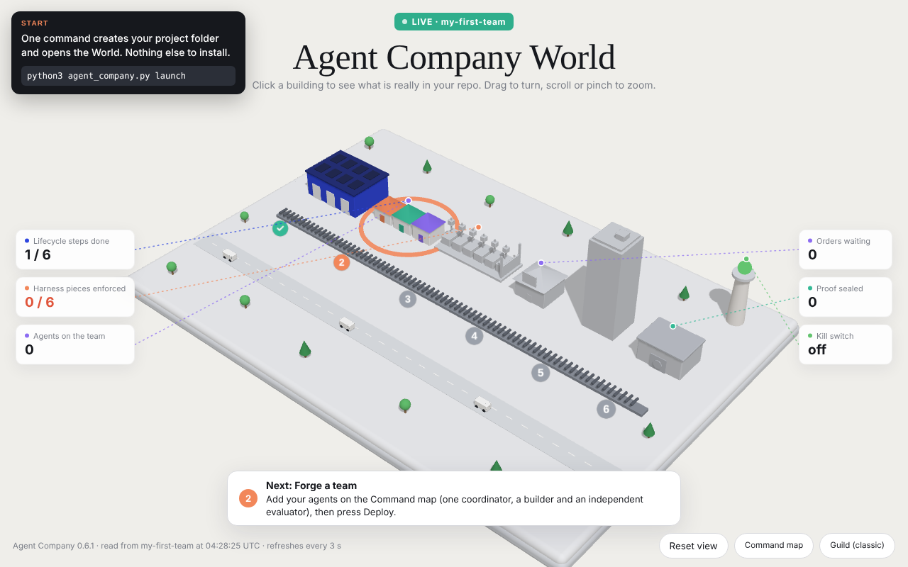
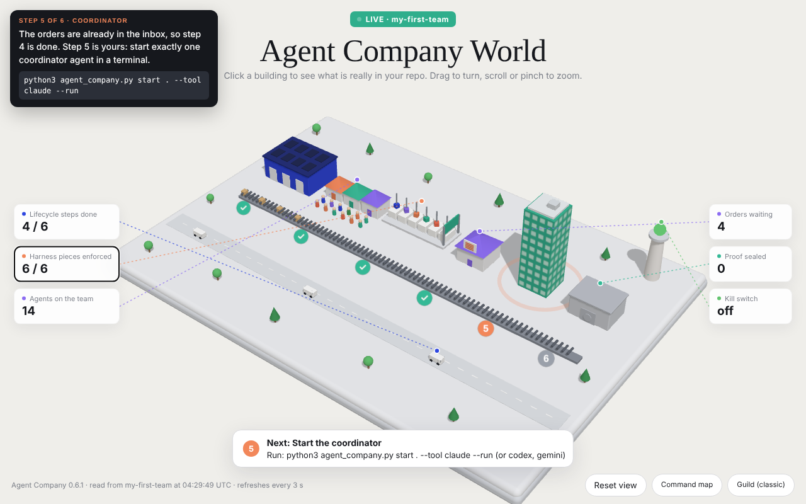
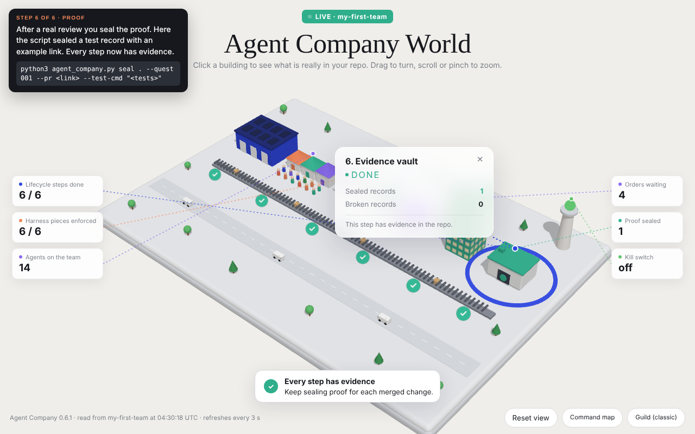

# The World: deploy an agent team step by step

The World is Agent Company's start screen. It is a live 3D view of one project folder on your own computer. Every building is one step of the deployment lifecycle, and it shows what is really in the repository, re-read every 3 seconds.

**Watch it first:** [`docs/media/world-demo.mp4`](media/world-demo.mp4) (2 min 13 s) is a recording of the steps below, driven in a real browser against a real project folder. Its captions say where the recording stands in for something only you can do.

## What you need

- Python 3.9 or later, and git. Nothing else is installed, and the World loads nothing from the internet.
- For step 5, one agent tool you already use: Claude Code, Codex or Gemini CLI.

## The six steps

### Start: one command

```sh
python3 agent_company.py launch            # or double-click "Start Agent Company"
```

This creates `~/agent-company-projects/my-first-team`, sets up git and `docs/ops/`, and opens the World. For a project you already have: `python3 agent_company.py world path/to/project`.

Step 1 (the depot) is already done. The orange ring, and the bar at the bottom, show the one next step. Buildings for later steps are grey until their turn.



### Step 2: add your team

Click **Command map**. Place your roles (one owner, exactly one coordinator, and a builder and an independent evaluator for each mission) and write your missions. Or press **Load OpenProof example** to see a full team. The readiness ring refuses a team that breaks the rules.


Press **Deploy**. It writes the orders into `docs/ops/` and never overwrites an instruction that is already there. Then press **Back to the World**.

### Step 3: install the harness

The harness is the set of limits an agent needs before you leave it alone. Press **Install the harness**. It fits all six pieces in this repo and keeps your old settings as `settings.json.before-agent-company`.

Click the Forge to see each piece. The card reads the result back from the repo; a piece shows a tick only when it is enforced.


### Step 4: orders

If you wrote missions in step 2, this step is already done: they are in `docs/ops/inbox/`. The Dispatch office shows how many are waiting.

### Step 5: start one coordinator (in a terminal)

```sh
python3 agent_company.py start . --tool claude --run     # or codex, gemini
```

Run exactly one. The Coordinator tower lights up when the coordinator writes its first status report (a real time in `docs/ops/outbox/STATUS.md`), and the dispatch line starts moving.



### Step 6: seal the proof (in a terminal)

After an independent review approves a pull request:

```sh
python3 agent_company.py seal . --quest 001 --pr <link> --test-cmd "<your tests>"
```

The Evidence vault counts sealed records, and shows a broken one in red if a record was edited afterwards.



## What the screen will not do

- **Skip a step.** A step shows as done only when every step before it is done.
- **Approve, merge, seal or lift the kill switch.** There is no button and no route for these. They stay with a named person, so an agent that reaches the screen cannot release itself.
- **Show a guess.** If the connection drops, the badge says so and the last state read stays on screen.

## Limits to know (20 Nov 2026)

- **Kill-switch tower.** It shows the kill switch from the Harness Marketplace runtime pack (`.harness/KILL`). That pack is not released, so on most projects the tower stays green.
- **The Command map loads its fonts from Google Fonts.** With no internet it still works, in a fallback font. The World itself loads nothing from outside.
- **Characters, proving and training** are still in the Guild (`python3 agent_company.py guild`), which stays until the World can do them.
- **The golden image check, audit score and red-team result** are not on the screen yet.

## How it was checked

| # | What must be true | Result on 20 Nov 2026 |
|---|---|---|
| 1 | One command takes a new user to the live World | Met: `launch` run for real in the recording |
| 2 | The screen shows only what is in the repo | Met: at 12 points in the recording the repo was read separately and matched the screen |
| 3 | Steps cannot be skipped | Met: `tests/test_world.py` |
| 4 | Every step can be finished from the on-screen instructions | Met for steps 1 to 4 and 6. Step 5 was a stand-in: the recording wrote the status line itself, and no AI agent ran |
| 5 | The screen cannot approve, merge, seal or lift the kill switch | Met: `tests/test_world.py` |
| 6 | Nothing loads from the internet | Met for the World. Not met for the Command map (fonts) |
| 7 | Usable on a phone | Met at 390 px wide: no sideways scroll |
| 8 | Every automated check passes | 113 of 116 unit tests, 45 of 45 browser checks and the claims check pass. The other 3 unit tests need `ssh-keygen`, which the build sandbox did not have |
| 9 | A real agent team runs the loop on the owner's machine | Not done yet |

Rows 4, 6, 8 and 9 are open. Until they close, treat the World as tested in a sandbox, not proven in use.
