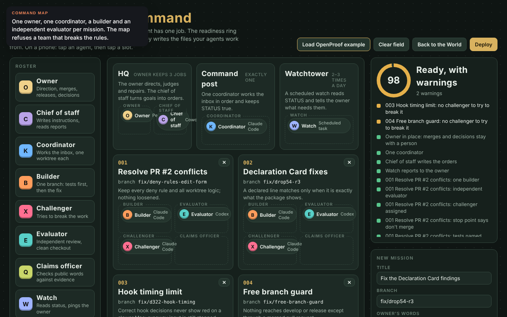
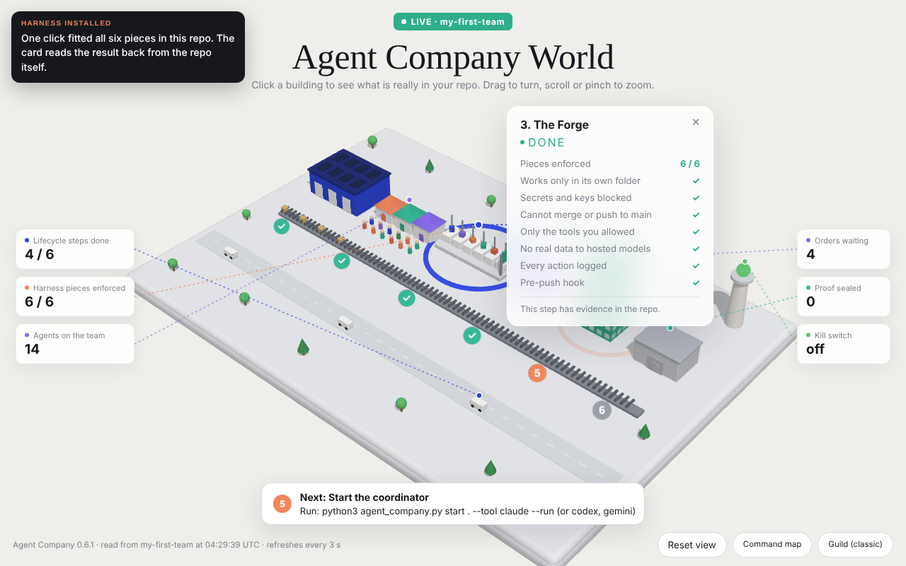

# The World: deploy an agent team step by step

The World is Agent Company's start screen. It is a live 3D view of one project folder on your own computer. Every building is one step of the deployment lifecycle, and it shows what is really in the repository, re-read every 3 seconds.

**Watch it first:** [`docs/media/world-demo.mp4`](media/world-demo.mp4) (2 min 13 s) is a recording of the steps below, driven in a real browser against a real project folder. Its captions say where the recording stands in for something only you can do.

**For the idea in one minute:** [`docs/media/the-line.mp4`](media/the-line.mp4) is a short narrated film. It is an illustration, not a recording.

## What you need

- Python 3.9 or later, and git. Nothing else is installed, and the World loads nothing from the internet.
- For step 5, one agent tool you already use: Claude Code, Codex or Gemini CLI.

## The six steps

### Start: one command

```sh
python3 agent_company.py launch            # or double-click "Start Agent Company"
```

This creates `~/agent-company-projects/my-first-team`, sets up git and `docs/ops/`, and opens the World. For a project you already have: `python3 agent_company.py world path/to/project`.

Step 1 (the depot) is already done. The orange ring, and the bar at the bottom, show the one next step. Buildings for later steps are grey until their turn.


### Step 2: add your team

Click **Command map**. Place your roles (one owner, exactly one coordinator, and a builder and an independent evaluator for each mission) and write your missions. Or press **Load OpenProof example** to see a full team. The readiness ring refuses a team that breaks the rules.



Press **Deploy**. It writes the orders into `docs/ops/` and never overwrites an instruction that is already there. Then press **Back to the World**.

### Step 3: install the harness

The harness is the set of limits an agent needs before you leave it alone. Press **Install the harness**. It fits all six pieces in this repo and keeps your old settings as `settings.json.before-agent-company`.

Then press **Commit the harness files**. Until its files are in git, a builder working in its own worktree would not have the guard, so the step stays open.

Click the Forge to see each piece. The card reads the result back from the repo; a piece shows a tick only when it is enforced.



### Step 4: orders

If you wrote missions in step 2, this step is already done: they are in `docs/ops/inbox/`. The Dispatch office shows how many are waiting.

### Step 5: start one coordinator (in a terminal)

```sh
python3 agent_company.py start . --tool claude --run     # or codex, gemini
```

Or with no window, one instruction at a time: `python3 agent_company.py run . --tool claude` (`--status` and `--stop` go with it). It refuses to start unless the harness is committed and the kill switch is off.

Run exactly one. The Coordinator tower lights up when the coordinator writes its first status report (a real time in `docs/ops/outbox/STATUS.md`), and the dispatch line starts moving.


### Step 6: seal the proof (in a terminal)

After an independent review approves a pull request:

```sh
python3 agent_company.py seal . --quest 001 --pr <link> --test-cmd "<your tests>"
```

The Evidence vault counts sealed records, and shows a broken one in red if a record was edited afterwards.


## What the screen will not do

- **Skip a step.** A step shows as done only when every step before it is done.
- **Approve, merge, seal or lift the kill switch.** There is no button and no route for these. They stay with a named person, so an agent that reaches the screen cannot release itself.
- **Show a guess.** If the connection drops, the badge says so and the last state read stays on screen.

## Limits to know (20 Nov 2026)

- **Kill-switch tower.** It shows the file `.harness/KILL`. While it exists the background runner will not start and a running one is ended. The commands that set and lift it come with the Harness Marketplace runtime pack, which is not released.
- **The background runner was tested with a stand-in tool,** not a live `claude -p` or `codex exec`. It adds no flag that skips permission checks, so a headless agent may need tools allowed in your settings first.
- **The Command map loads its fonts from Google Fonts.** With no internet it still works, in a fallback font. The World itself loads nothing from outside.
- **Characters, proving and training** are still in the Guild (`python3 agent_company.py guild`), which stays until the World can do them.
- **The golden image check, audit score and red-team result** are not on the screen yet.

## How it was checked

| # | What must be true | Result on 20 Nov 2026 |
|---|---|---|
| 1 | One command takes a new user to the live World | Met: `launch` run for real in the recording |
| 2 | The screen shows only what is in the repo | Met: at 12 points in the recording the repo was read separately and matched the screen |
| 3 | Steps cannot be skipped | Met: `tests/test_world.py` |
| 4 | Every step can be finished from the on-screen instructions | Met in a sandbox: in the real agent run below, a coordinator agent wrote the status report and an evaluator agent ran `seal`. (In the recording, step 5 was a stand-in.) |
| 5 | The screen cannot approve, merge, seal or lift the kill switch | Met: `tests/test_world.py` |
| 6 | Nothing loads from the internet | Met for the World. Not met for the Command map (fonts) |
| 7 | Usable on a phone | Met at 390 px wide: no sideways scroll |
| 8 | Every automated check passes | 133 of 133 unit tests pass in a Linux shell on the owner's Mac. In the build sandbox 130 of 133 pass; the other 3 need `ssh-keygen`, which it did not have. 45 of 45 browser checks (build sandbox) and the claims check pass. Not yet run natively on macOS |
| 9 | A real agent team runs the loop on the owner's machine | Partly: real agents ran the loop in a cloud sandbox (below), without the tool-call guard and without a GitHub pull request. Not yet run on the owner's machine |

Rows 6 and 9 are open, and row 8 has not been run natively on macOS. Until they close, treat the World as tested in a sandbox, not proven in use.

## A real agent run (20 Nov 2026, cloud sandbox)

Three separate AI agents ran one instruction through the loop in a throwaway project, each started with only its role and the files in `docs/ops/`. The World showed each change as it landed.


| Role | What the agent did | Checked how |
|---|---|---|
| Coordinator | Read the standing orders, made the worktree and branch, wrote the builder's brief and `STATUS.md` | `git worktree list`, `git ls-remote origin` |
| Builder | Committed the failing tests (1 error), then the code (10 of 10 pass), pushed its own branch only | Two commits, one file each; `origin/main` unchanged |
| Evaluator | Fresh clone; re-ran both commits; changed the code five ways to confirm the tests catch it; 32 counter-examples, every Unicode code point and 200,000 random strings against the written rule: 0 defects. Approved and ran `seal` | Record `001-0ab87dc28830` verifies as SEALED |
| Coordinator | Re-checked every claim against the remote, kept the instruction in the inbox because nothing is merged, and listed the merge and five decisions under "Needs the owner" | `git merge-base --is-ancestor` exits 1 |

Afterwards a push of the branch onto `main` was tried on purpose. The pre-push hook refused it: "push to the protected branch 'main' refused".

**What this run does not show**
- **The tool-call guard was not active for these agents.** They were sub-agents of another session, which does not load this project's `.claude/settings.json`. Only the git pre-push hook was enforcing. A run with Claude Code started inside the project is still needed.
- **No GitHub pull request.** The remote was a plain git folder, so the evaluator's brief and verdict stood in for the pull-request page, and `verify` shows that one line unticked.
- **One vendor.** Builder and evaluator were the same model family.
- **Not the owner's machine, and no merge.** The owner's merge is the last step and was not taken.

**What the agents found (open, for the owner)**
1. **Fixed since:** the World now keeps the harness step open until its files are committed, and `harness --commit` or the Commit button does it. As found: **the harness files are not committed by the install** (`AGENTS.md`, `.claude/`, `docs/ops/harness/`). A worktree made from `main` does not contain them, so a builder session started inside its worktree would load no guard hooks. The shared git pre-push hook still applies.
2. **The allowlist is empty after install** when the team comes from the Command map.
3. **"Outbox" is ambiguous** between the main folder and the worktree's copy. This run used the main folder.
4. **Step 6 of the standing orders reuses the builder's file name** (`001_report.md`) for the coordinator's closing report.
5. **The verdict file cannot name the sealed record**, because sealing happens after the verdict is written.
6. **`ROLES.md` is left unfilled** by a Command map deploy.
